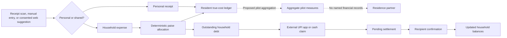

# MoneyMinder innovation thesis

Status basis: 26 July 2026

This document assesses product differentiation, not patent novelty. It does not
claim that MoneyMinder invented receipt OCR, budgeting, expense splitting, debt
simplification, recurring bills, UPI deep links, PWA packaging, browser
extensions, or Android WebViews.

The [pitch claims baseline](PITCH.md#claims-baseline) controls commercial
statements: the repository contains working, release-gated source but no
supplied external launch, traction, revenue, market-size, team, fundraising, or
measured-impact evidence.

## Thesis

MoneyMinder's credible innovation is a trust-and-distribution system for a
mixed personal and shared money problem:

> Turn personal purchases and each resident's exact share of household costs
> into one explainable monthly ledger; route repayment through existing payment
> apps without pretending to execute or verify the payment; and test the
> workflow through complete-room onboarding with aggregate-only partner
> reporting.

This is primarily **workflow and operating-model differentiation**, supported
by financial-integrity engineering. The strongest potential advantage is not an
algorithm. It is a repeatable way to activate whole rooms, preserve resident
trust, and prove outcomes. That advantage does not exist until field evidence
shows it works.

## System of differentiation



No single box is unusual. The proposition depends on the connections and the
trust rules between them.

## Innovation assessment

| Layer | Current status | Assessment |
| --- | --- | --- |
| Personal plus shared "true cost" | Implemented | Genuinely differentiated product framing; technical calculation is straightforward and reproducible |
| Mixed receipt line routing | Implemented with gaps | Useful workflow composition; not a proprietary OCR breakthrough |
| Deterministic financial integrity | Implemented | Necessary trust infrastructure; not a moat by itself |
| UPI handoff plus recipient confirmation | Implemented | A deliberate trust boundary that avoids false payment certainty; UPI itself is standard |
| Consent-based cross-surface capture | Implemented | Coherent capture strategy; PWA, MV3, and WebView components are standard |
| Complete-room sponsored onboarding | Designed, not validated | Strongest distribution hypothesis and possible source of defensibility |
| Aggregate-only partner reporting | Policy and pilot design; field operation unvalidated | Differentiated buyer/resident boundary if partners accept it |
| Outcome evidence and benchmarks | Not yet present | Potential future asset, not a current advantage |

## 1. One resident-level cost model

Most category labels separate "personal budgeting" from "group expenses."
MoneyMinder instead computes:

```text
true monthly cost
  = personal receipts in the month
  + the resident's allocated share of household expenses in the month
```

[`server/api.js`](../server/api.js) applies that model to the dashboard and
insights. [`server/money.js`](../server/money.js) validates amounts and allocates
integer paise. [`public/index.html`](../public/index.html) presents total,
personal, and shared values together.

The differentiation is the user model: a shared expense is not merely an amount
owed to a roommate; it is part of the resident's actual cost of living. The
calculation is not hard to copy. Its value must be demonstrated by whether
residents understand it, return to it, and make better decisions with it.

## 2. Mixed-purchase routing at capture time

[`server/ocr.js`](../server/ocr.js) extracts editable receipt fields and line
items using a bundled, checksum-verified English Tesseract model.
[`public/scan.html`](../public/scan.html) lets the user mark each extracted line
as personal or shared. Personal lines become receipt records; shared lines
become household expenses.

This reduces a real reconciliation step: a grocery receipt containing personal
and communal items does not have to be entered once in a budget and again in a
split ledger.

The implementation has important limits:

- OCR and the parser are conventional and currently English-only.
- The user must review and correct the result.
- Shared lines do not yet retain a durable link back to the source receipt or
  image.
- The browser saves lines sequentially. Idempotency prevents retry duplicates,
  but the entire receipt partition is not one atomic transaction.

Durable provenance and an all-lines atomic save are credible next improvements
only if mixed receipts matter in observed use.

## 3. Financial trust instead of payment theater

[`server/households.js`](../server/households.js) and
[`server/money.js`](../server/money.js) enforce several invariants:

- money parses to bounded, two-decimal INR values;
- aggregation and splits use safe integer paise;
- duplicate members do not receive duplicate shares;
- uneven paise remainders are assigned deterministically;
- a payer and recipient must be different active household members;
- a settlement cannot exceed the current computed debt;
- retry-prone writes can replay safely with the same idempotency key;
- settlement begins as pending and changes balances only after the recipient
  confirms it.

The UPI link is an external handoff. MoneyMinder does not hold funds, read bank
data, request a PIN, or infer success from returning to the app. That restraint
is more important than the deep link itself. The end-to-end confirmation rule is
covered by [`server/e2e.test.js`](../server/e2e.test.js).

This may create trust, or it may create friction. Only observed completion time,
abandonment, disputes, and interviews can decide.

## 4. Capture breadth with explicit consent

MoneyMinder uses three surfaces:

- The server datastore and calculations are the data source of truth; the
  web/PWA is the primary product surface.
- Android is a thin WebView host for validated receipt-image selection, cookies,
  target-36 safe areas, and safe external intents.
- The Chrome extension offers budget context and purchase-page suggestions.

The extension is deliberately advisory. Purchase detection is off by default,
broad HTTPS-page analysis is requested only when enabled, page analysis stays
inside the extension, candidates live in per-tab session storage, and nothing is saved
until the user selects **Track**. Evidence lives in
[`extension/detect.js`](../extension/detect.js),
[`extension/background.js`](../extension/background.js), and
[`extension/README.md`](../extension/README.md).

These are standard platform capabilities. The differentiated intent is to make
capture available at the moment spending occurs without turning MoneyMinder
into a surveillance or auto-posting system.

## 5. Distribution as part of the product

Shared-expense software has a social dependency: one isolated user cannot
create a complete household ledger. MoneyMinder's proposed answer is not a
better invite button. It is a residence-sponsored, complete-room onboarding
program for adults during a bounded "first month away from home" period.

The sponsor hypothesis is:

1. a residence can convene complete rooms more efficiently than consumer
   acquisition can;
2. one workshop and a weekly reminder can create enough coordinated use to test
   the product;
3. room-level activation, week-two return, expense activity, settlement
   confirmation, reimbursement age, and money clarity are better evidence than
   downloads;
4. a partner can support and pay for the program without seeing named resident
   finances.

This is currently a protocol in
[`PILOT-PROPOSAL.md`](PILOT-PROPOSAL.md) and
[`GO-TO-MARKET.md`](GO-TO-MARKET.md), not an implemented distribution engine or
proven sales motion.

## What is standard

| Component | Why it matters | Why it is not defensibility |
| --- | --- | --- |
| Node/Express and vanilla web UI | Small, understandable delivery surface | Widely available tooling |
| Embedded SQLite and server-side sessions | Durable single-instance state and authentication without a separate database service | Standard infrastructure |
| One serialized application-state row | Simple transactional pilot topology | A scale ceiling, not an advantage |
| Tesseract OCR | Removes third-party OCR calls and API-key dependency | Open-source, English-only, CPU-bound |
| Receipt categories and charts | Familiar budgeting experience | Baseline category functionality |
| Join codes, recurring bills, debt simplification | Complete household workflow | Common shared-expense patterns |
| UPI deep links | Reuses installed payment apps | A public platform capability |
| PWA and Android WebView | Reuses one phone-first product | Standard packaging; wrapper maintenance remains |
| Chrome Manifest V3 extension | Convenient web-purchase capture | Standard browser platform surface |
| bcrypt, rate limits, security headers, health checks | Required operational hygiene | Table stakes, not product differentiation |

Engineering quality can earn trust and reduce execution risk, but it should not
be described as a unique market moat.

## Defensibility

### Current defensibility: limited

- The code and algorithms can be reproduced.
- There is no supplied patent, proprietary model, exclusive data, signed
  distribution agreement, brand evidence, or switching-cost evidence.
- Group records create local utility, not a demonstrated cross-market network
  effect.
- No outcome benchmark or residence deployment playbook has been earned yet.

### Potential defensibility if validated

1. **Institutional access and repeatable activation.** Relationships, consent
   materials, staff training, complete-room onboarding, support practices, and
   a measured launch playbook can be harder to reproduce than features.
2. **Outcome evidence.** Consistent, de-identified benchmarks for activation,
   reimbursement age, clarity, attrition, and failure modes could improve
   selling and implementation. Resident financial data itself must not become a
   moat.
3. **Trust architecture.** A reputation for explainable totals, deterministic
   splits, recipient confirmation, privacy boundaries, deletion, and honest
   reporting can compound, although competitors can copy individual controls.
4. **Workflow integration.** Requested integrations with residence systems may
   create operational switching costs after the core pilot proves value.
5. **Learning velocity.** A disciplined kill-test loop can avoid feature parity
   work and accumulate segment-specific knowledge.

Each item is conditional. A second partner adopting the same playbook with less
founder effort would be stronger evidence than a long feature list.

## Limitations and failure modes

### Evidence

- There is no supplied live use, retention, partner, payment, revenue, impact,
  market-size, or team evidence.
- The target segment and buyer are repository-inferred hypotheses.
- Pilot thresholds are proposed decision rules, not outcomes.

### Product

- The unified true-cost view may not be valuable enough to replace separate
  habits.
- A useful household still depends on coordinated member activation.
- Recipient confirmation can be forgotten or disputed.
- Mixed-receipt provenance and all-lines atomicity are incomplete.
- English receipt OCR can fail on layout, image quality, language, or merchant
  conventions; manual correction remains essential.
- There is no bank feed, automatic payment verification, dispute resolution,
  multi-currency support, financial advice, or autonomous money movement.

### Distribution and business

- Residence staff may not own this problem, have budget, or accept additional
  onboarding work.
- Aggregate-only reporting may be insufficient for a buyer, while broader
  reporting would violate the resident trust proposition.
- A free evidence pilot may not convert to paid use.
- Larger residence platforms can build a module or bundle similar functions.

### Technical and operational

- Production state is one version-guarded serialized row in embedded SQLite
  under a single-container topology capped at 30 active pilot accounts. It is
  appropriate only while write throughput and reporting remain small.
- OCR is one bounded in-process worker, so throughput is intentionally limited.
- Receipt images require a durable filesystem volume coordinated with the
  SQLite backup and deletion lifecycle.
- Android and Chrome add platform-policy, signing, permission, and release work.
- External launch remains blocked on real host, legal, monitoring, restore,
  signing, and final-device decisions listed in
  [`PRODUCTION-READINESS.md`](PRODUCTION-READINESS.md).

## Alternatives and competition categories

This is a category comparison, not a market-share or superiority claim.
Public examples and sourced observations already used by the project are in
[`GO-TO-MARKET.md`](GO-TO-MARKET.md).

| Alternative category | Optimized job | MoneyMinder's proposed distinction | Competitive risk |
| --- | --- | --- | --- |
| Shared-expense ledger | Record group costs and simplify balances | Adds personal budget context and mixed personal/shared receipt routing | Mature products already cover much of the household feature set |
| UPI or payment app | Move money between people | Keeps an explainable household ledger and requires recipient confirmation | Existing trust and distribution make another payment destination unnecessary |
| Personal budget or receipt tracker | Understand individual spending | Includes allocated household share in the same monthly cost | Users may prefer separation or an established finance app |
| Spreadsheet, notes, or chat | Flexible, free coordination | Adds deterministic calculations, explicit pending/confirmed status, and a durable shared ledger | Manual tools may be good enough for small rooms |
| Residence/property platform | Operate tenants, property, billing, and communications | Proposes a focused resident money-coordination program | Platforms have buyer access and can build or bundle the feature |
| Residence staff process | Mediate issues without software | Gives residents a private ledger and gives staff only aggregate outcomes | The problem may not justify a dedicated product |

The correct positioning is not "better at every job." It is "a narrower
personal-plus-household workflow with a measurable complete-room program."

## Validation plan

All commercial and impact measures below are hypotheses. The protocol must be
fixed before data collection, with denominators and attrition reported.

| Thesis to test | Method | Evidence | Falsifier |
| --- | --- | --- | --- |
| The problem is recent and material | Interview 12 outstation students with concrete-event prompts | De-identified incident table | Fewer than 8 describe a recent relevant problem |
| A buyer owns the outcome | Interview five residence/community managers and three budget owners | Named role, problem, budget path, next step | Fewer than 2 of 3 budget owners accept a concrete next step |
| A partner can convene a cohort | Seek one property, date, and 30+ adults | Dated written commitment | No dated pilot after ten qualified buyer conversations |
| Complete-room sponsorship changes activation | Run the preregistered cohort across at least ten complete rooms | Invited-to-joined and room-level activation funnel | Below 60% joining in 48 hours or below 50% complete-room activation |
| The product earns repeat use | Measure week-two return and active-room entries | Account and room denominators, not page views | Below 35% week-two return or median active room below 6 expenses |
| Unified cost improves clarity or coordination | Baseline/endline questions plus reimbursement-age records | Sample size, attrition, distribution, and qualitative explanations | Neither 25% faster reimbursement nor 20% clearer money/roommate transparency |
| Confirmation creates trust without excessive friction | Measure pending-to-confirmed time, abandonment, rejection, correction, and disputes | Settlement funnel and interviews | Residents bypass, abandon, or distrust the flow often enough to prevent routine use |
| A buyer will pay | Offer the documented paid ranges after evidence review | Payment or dated budget commitment | No payment of at least ₹10,000 and no commitment of at least ₹30 per activated resident |
| The playbook can repeat | Run a second property with the same privacy and measurement contract | Setup effort, activation, support load, and outcome comparison | Results require bespoke founder effort or do not reproduce |

The institutional wedge should be stopped if the live cohort misses two of
activation, retention, value, and payment thresholds. Passing one engagement
metric is not enough.

## Evidence collection rules

- Finish every live-cohort gate before enrollment.
- Record invited, joined, complete-room activated, week-two active, expenses,
  pending settlements, confirmed settlements, and attrition with denominators.
- Do not convert invitations into users, users into retained users, or
  self-reported clarity into financial savings.
- Give partners aggregate results only; do not expose named purchases, receipt
  images, household balances, or UPI IDs.
- Preserve consent, opt-out, deletion, and data-retention evidence.
- Report OCR corrections, partial receipt saves, failed settlements, disputes,
  null outcomes, and negative feedback.
- Publish the method and limitations alongside any favorable result.

## Decision roadmap

1. **Problem gate:** complete interviews and reject the wedge if recent pain and
   buyer ownership are absent.
2. **Readiness gate:** close host, legal, privacy, monitoring, restore, signing,
   and final-device requirements.
3. **Pilot gate:** preregister the four-week protocol, measures, privacy boundary,
   support owner, and stop conditions.
4. **Value gate:** require activation, repeat use, and resident outcome evidence.
5. **Commercial gate:** require a real payment or dated budget commitment.
6. **Repeatability gate:** reproduce the program at a second property before
   claiming a distribution advantage.
7. **Scale gate:** normalize data and redesign OCR/job ownership only when
   measured throughput or reporting needs exceed the single-container model.

## Bottom line

MoneyMinder is not defensible because it contains more finance features. Its
credible thesis is that one true-cost ledger, careful settlement truth, and
complete-room distribution can work together better than a stack of separate
tools. The product integration is real; the market advantage is not yet proven.
The next innovation milestone is evidence, not another feature.
