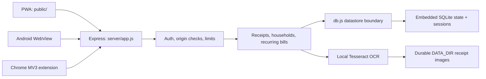

# MoneyMinder agentic engineering handoff

This is the canonical project-specific handoff for coding agents and maintainers.
Read it completely before changing the repository. Current user/developer
instructions override this file; otherwise preserve these constraints. If code
and this document diverge, verify the tested behavior and update both in the same
change.

## Product and release status

MoneyMinder is a phone-first, self-hosted budgeting application for personal
receipt tracking and shared household expenses. The same backend serves three
clients:

- a vanilla HTML/CSS/JavaScript progressive web app;
- a native Android WebView wrapper with validated receipt-image selection and
  external-intent integration;
- a Chrome Manifest V3 companion extension with opt-in, local purchase-page
  detection.

The repository contains production-hardened source and store-listing materials.
It is **not proof of a live service, store approval, users, revenue, partnerships,
or market validation**. Do not claim any of those without operator-supplied
evidence.

Start with:

- [README](../../README.md) for the product and local setup;
- [architecture](ARCHITECTURE.md) for the supported single-instance SQLite
  envelope and the changes required before unrestricted enrollment;
- [production readiness](../PRODUCTION-READINESS.md) for deployment truth and
  unresolved launch gates;
- [store upload kit](../../store-listing/README.md) for console copy and assets;
- [Android guide](../../android/README.md) and
  [Play release runbook](../../android/RELEASE.md);
- [extension guide](../../extension/README.md).

## Runtime architecture



There is no frontend compilation or client framework. Express serves `public/`
directly. Production is intentionally a **single application container/process**
with one durable `DATA_DIR`:

- application state and browser sessions share one embedded SQLite database;
- receipt images live beside that database under the durable filesystem;
- the database and schema are created automatically at startup;
- OCR, SQLite write serialization, recurring work, upload quotas, cleanup, and
  rate-limit counters are local to one process.

The canonical OCI pilot adds only host-level Caddy for public HTTPS; it has no
database or OCR service. Do not add replicas without redesigning shared rate
limiting, receipt storage, OCR scheduling, recurring-job ownership, session
coordination, and write throughput. The supported zero-cost launch envelope is
one process and at most 30 active pilot accounts, not unrestricted enrollment
or a tested 10,000-user topology.

The fixed pilot limits are one replica, 25 MiB serialized application state,
10,000 receipt files, 4 GiB receipt bytes globally, and 200 files/100 MiB per
account. OCR admission is 1 scan/account/minute and 2 scans/process/minute.
These are policy/configuration ceilings, not load-test evidence; SQLite, OCR,
rate limits, or host resources may bind earlier.

## End-to-end behavior

### Browser/PWA request path

1. `server/app.js` assigns or validates a request ID, applies security headers,
   rate limits API traffic, limits JSON bodies, and performs extension CORS and
   mutation-origin checks.
2. Open registration/login/logout routes run before the authenticated API gate.
3. `server/auth.js` resolves a browser session or extension bearer token and
   attaches `userKey`, `authVersion`, and `authType`.
4. Bearer tokens pass an additional route-scope gate. Sensitive account
   operations require a browser session.
5. Domain handlers validate the request and change state through `db.update()`.
6. `server/http.js` maps async handler failures into the central error handler.
   API errors expose a short `{ "error": "..." }` response; server logs retain
   request ID, error class/code, and no submitted secrets.
7. `public/js/api.js` handles same-origin credentials, error decoding, login
   redirects, output escaping, money formatting, and browser-generated
   idempotency keys.
8. `public/sw.js` caches only the static shell. API reads are network-first and
   API responses are never cached.

### Sponsored merchant-offer path

This is a disabled-by-default PWA/Android capability, not a launched ad product.
`PROMOTIONS_ENABLED` accepts only `true` or `false` and defaults to `false`.
With the flag off, authenticated
`GET /api/promotions/current` returns `{ "promotion": null }` without querying
promotion storage, while event writes return `404`.

The routes sit behind session authentication and the normal API controls.
Chrome bearer tokens are rejected by the bearer-scope gate. The current-offer
read is limited to 120 requests/minute/IP. Telemetry is limited to
30 requests/minute/IP and 10/minute/authenticated user; the coarse
600 requests/minute/IP API ceiling also applies. An enabled read selects one
active campaign inside its UTC schedule, ordered by latest start then ID.
It receives no user, receipt, financial, household, browser, or device input, so
every signed-in browser receives the same current offer. Only canonical UUID,
bounded plain-text title/description/CTA, and a bounded credential-free,
default-port HTTPS URL on a public DNS-style hostname leave the server. Runtime
validation rejects explicit ports, IP literals, localhost/private-style names,
and special-use suffixes. There is no campaign-admin HTTP API and no
user-supplied campaign write. Before a controlled database change activates a
row, the operator must verify the merchant's identity and control of the
destination and manually review the exact public HTTPS URL, redirect behavior,
offer content, schedule, and age/content suitability.

The dashboard keeps the card hidden until that response passes an independent
client validator. It renders dynamic fields with `textContent`, displays the
exact **Sponsored** label, offers an accessible page-local dismiss button, and
does not block the core dashboard when the optional request or event reporting
fails. An impression is attempted only after at least 50% of the card is
visible; a click is attempted only from a trusted link click. Each uses a fresh
random event-scoped `Idempotency-Key`.

`POST /api/promotions/:id/events` accepts exactly one body field,
`eventType: "impression" | "click"`. It validates the campaign UUID and
idempotency key, hashes the key with SHA-256, and passes only campaign ID, event
type, UTC metric date, and key hash to SQLite. It never persists the
authenticated user or request IP. The transaction deduplicates retries and
increments a per-campaign UTC daily counter; a click reconciles at least one
impression so `clicks <= impressions` remains true.

Client event delivery is best-effort. Treat its aggregate counts as
approximate, non-billing telemetry, not proof of a conversion or redemption.
Any commercial outcome must be confirmed by the merchant through a separately
approved process.

`promotion_event_dedup` cleanup is currently triggered by a later event. Rows
become eligible for pruning after 48 hours, but that is not a guaranteed
wall-clock deletion when traffic stops. Do not promise a strict 48-hour
retention or enable promotions until a scheduled/operational cleanup and the
daily aggregate retention period are implemented, tested, and disclosed.

### Receipt scan path

1. `POST /api/parse-receipt` accepts one multipart field named `input`.
2. Multer caps the upload before OCR. `server/ocr.js` then verifies JPEG/PNG
   magic bytes and bounded image dimensions.
3. A single in-process Tesseract worker uses the bundled, checksum-verified
   English model. Recognition is serialized, queue depth and execution time are
   bounded, and no OCR provider or model CDN receives the image.
4. Pure parser helpers derive amount, date, supplier, payment document,
   category, and line items. The user can correct the result before saving.
5. The image is written under `DATA_DIR/uploads/<userKey>/` only after the
   authenticated account is rechecked inside the datastore transaction.
6. `POST /api/receipts` validates the corrected record, verifies any image still
   exists, and stores it. Unreferenced scan images become cleanup candidates
   after 24 hours and are checked hourly as well as on later uploads; explicit
   receipt/account deletion uses the durable deletion outbox in
   `server/uploads.js`.

### Shared-expense path

`server/households.js` owns household membership, expense splits, balances,
settlements, and recurring-bill definitions. `server/recurring.js` posts due
bills on startup and every six hours, guarded by `lastPostedYM` so the same
definition posts once per application-time-zone month.

Expense allocation and balance simplification operate in integer paise.
Settlements start as `pending` and do not alter balances until the recipient
confirms them. UPI is an external payment intent, not a payment processor or
proof of transfer.

### Chrome extension path

The unpacked development extension points at localhost. A release ZIP is created
only through `scripts/package-chrome.mjs`, which:

- validates one real public HTTPS server origin;
- copies an explicit runtime-file allowlist;
- rewrites the API host permission and default API origin in a staging copy;
- places `manifest.json` at the ZIP root;
- removes the staging directory.

The Store build has no runtime server selector. Its required API permission and
`DEFAULT_API` are the same packaged HTTPS origin. Optional `https://*/*`
permission is used only for local purchase detection and can be removed without
affecting the required API host. Do not reintroduce custom-server storage,
prompts, or permissions without a new threat model and matching disclosure.

Extension login sends `X-Client: extension` and receives a bearer token. The
server permits that token only to read summary/household data and create
receipts/expenses. Purchase detection is disabled by default. After explicit
permission, content scripts inspect HTTPS page text locally and send only a
candidate to the extension service worker. Page content is not uploaded; an
expense leaves the browser only after the user selects **Track**.

After `db.init()`, startup calls `initializeTokenCache()` before OCR validation
or HTTP listening. It hydrates a copy-on-write map with valid stored digest
metadata so known tokens do not consume the process-global unknown-token flood
budget; every bearer still passes the per-IP limiter. This cache is never
authorization authority: `requireAuth` reloads datastore state and validates
digest, user, expiry, and `authVersion`. Token issue, revocation, account
deletion, successful validation, and expiry replace or remove cache entries.

### Android path

`android/app/src/main/java/com/moneyminder/app/MainActivity.kt` is a
single-activity WebView wrapper. It keeps exact-origin HTTP(S) navigation inside
the WebView and dispatches only user-initiated main-frame navigation for the
explicit `https`, `upi`, `tel`, `sms`, `mailto`, and `whatsapp` external
allowlist. Every dispatched `ACTION_VIEW` is browsable; script/subframe,
cleartext external HTTP, `intent:`, `market:`, malformed, and unknown schemes
are blocked. The wrapper disables file/content access and third-party cookies
and bridges Android's single-item content picker. It accepts only one readable
JPEG/PNG `content:` URI, requests no camera or broad media permission, keeps
WebView inside all system-bar/display-cutout edges on target SDK 36, removes
orientation locking, and explicitly supports resizable/large-screen windows.

Debug builds may use emulator/LAN HTTP through a debug-only network policy.
Release builds require a controlled public HTTPS origin and real upload signing
configuration. Those values are validated by Gradle before release
assemble/bundle tasks.

## Data model and ownership

The logical application state contains:

| Collection | Purpose | Ownership rule |
| --- | --- | --- |
| `users` | Profile, budget, password digest, auth version | Keyed by normalized username |
| `receipts` | Personal receipt metadata and image filename | `userKey` must match the authenticated account |
| `households` | Invite code, owner, members, recurring definitions | All detail/mutations are membership-gated |
| `expenses` | Shared ledger entries | Payer must be an active household member |
| `settlements` | Pending/confirmed transfers | Recipient alone confirms a pending transfer |
| `tokens` | SHA-256 digests of extension bearer tokens | Bound to user and auth version |
| `pendingUploadDeletes` | Durable image/user-directory deletion work | Internal outbox; never expose as product data |
| `promotion_campaigns` | Approved bounded merchant copy, HTTPS destination, status, and schedule | SQLite table; one non-targeted active offer is selected |
| `promotion_daily_metrics` | UTC daily impression/click totals | Aggregate by campaign/date; no user or device dimension |
| `promotion_event_dedup` | SHA-256 event-key receipts for retry safety | Campaign/type only; never store user, IP, household, receipt, or device data |

Persistence files:

- `server/migrations/001_app_state.sql` creates the JSON state and session
  tables;
- `server/migrations/002_promotions.sql` creates bounded scheduled promotion
  campaigns, daily aggregate counters, and event-key deduplication receipts; it
  does not normalize the core `app_state` financial model;
- `server/migrations.js` serializes and records idempotent SQLite migrations;
- `server/db.js` owns the SQLite connection, transaction, serialization, size,
  rollback, readiness, and lifecycle behavior;
- `server/sqlite-maintenance.js` owns integrity-checked backup and
  credential-sanitizing restore.

`db.update(fn)` is the deliberate immutability exception: `fn` receives
transaction-scoped mutable state. Never retain that object, mutate a `db.load()`
result, write state outside `db.update()`, or perform an unrelated slow/network
operation while holding the state lock.

## File map

| Path | Responsibility | Primary checks |
| --- | --- | --- |
| `server/app.js` | Middleware order, routes, health, lifecycle, error mapping | `server/app.test.js`, `server/e2e.test.js` |
| `server/config.js` | Environment parsing and fail-fast production validation | `server/config.test.js` |
| `server/auth.js` | Sessions, registration/login, extension tokens, profile/export/deletion | `server/auth.test.js` |
| `server/api.js` | Receipt CRUD, image authorization, dashboard/insights | `server/api.test.js` |
| `server/households.js` | Membership, expenses, balances, settlement confirmation, recurring definitions | `server/households.test.js` |
| `server/recurring.js` | Monthly recurring expense posting | `server/recurring.test.js` |
| `server/ocr.js` | Model verification, bounded OCR, image validation, parsers | `server/ocr.test.js` |
| `server/uploads.js` | Safe paths, quotas, durable deletion retries | `server/uploads.test.js` |
| `server/money.js` | Money validation and paise arithmetic | `server/money.test.js` |
| `server/time.js` | Application-zone calendar dates/months | `server/time.test.js` |
| `server/http.js` | Async route wrapper, idempotency syntax, stale-auth check | `server/http.test.js` |
| `server/promotions.js` | Non-targeted current offer, strict event validation, aggregate SQLite metrics | `server/promotions.test.js`, `server/app.test.js`, SQLite integration |
| `server/db.js`, `server/migrations.js`, `server/sqlite-maintenance.js` | SQLite persistence, schema lifecycle, backup, and restore | matching `*.test.js`, `server/sqlite-integration.test.js` |
| `public/` | PWA pages, styling, same-origin API client, charts, service worker | `public/ui.test.js`, `server/e2e.test.js` |
| `extension/` | MV3 popup, page detection, service worker, icons | `extension/detect.test.js`, `extension/platform.test.js` |
| `android/` | WebView client, release validation/signing, Android resources | Gradle validation, lint, assemble/bundle |
| `scripts/package-chrome.mjs` | Reproducible release ZIP | `test/chrome-package.test.js` |
| `scripts/verify-release-artifact.mjs`, `scripts/verify-production-enrollment.mjs` | Exact store-artifact identity and fail-closed pilot acceptance gates | `test/release-gates.test.js` |
| `deploy/oci/` | Operator-facing OCI pilot deployment, check, backup, retention, and restore-drill package | `test/oci-deployment.test.js`, `deploy/oci/check.sh`; canonical deployment guide |
| `store-listing/` | Console answers and policy-sized public assets | `test/store-readiness.test.js` |
| `.github/workflows/verify.yml` | Full dependency, Node, container, SQLite, Chrome, and Android CI gates | GitHub Actions |

Tests normally live beside the module. Cross-surface release tests live in
`test/`.

## Local setup

The repository provisionally pins Node.js `24.18.0` and npm `10.9.8`. CI
intentionally blocks that Node pin after 2026-07-26 because of the announced
2026-07-27 security release. On or after that date, first repin `package.json`,
`Dockerfile`, and `.github/workflows/verify.yml` to the published patched Node
24.x release,
then run every gate below.

PowerShell:

```powershell
npm ci --ignore-scripts
Copy-Item .env.example .env
npm start
```

The development server listens on `http://localhost:3000`. A missing development
session secret produces a random per-boot secret and therefore logs users out on
restart; production rejects that configuration.

For Android development, use JDK 17, Android SDK platform 36, build-tools 35 or
newer, and a local gitignored `android/local.properties`. The committed Gradle
wrapper supplies Gradle itself.

## Environment-variable inventory

Names only; values belong in local `.env`, CI secrets, or the deployment secret
manager.

Production/runtime:

```text
NODE_ENV
APP_ORIGIN
LISTEN_HOST
SESSION_SECRET
DATA_DIR
SQLITE_FILE
DATA_MAX_BYTES
UPLOAD_TOTAL_MAX_BYTES
UPLOAD_TOTAL_MAX_FILES
APP_TIME_ZONE
REGISTRATION_ENABLED
PROMOTIONS_ENABLED
TRUST_PROXY
EXTENSION_ORIGIN
PORT
```

Development/testing compatibility:

```text
SESSION_COOKIE_SECURE
```

Release build:

```text
MONEYMINDER_SERVER_URL
BUNDLETOOL_JAR
MONEYMINDER_EXPECTED_BUNDLETOOL_SHA256
MONEYMINDER_EXPECTED_SIGNER_SHA256
MONEYMINDER_EXPECTED_AAB_SHA256
MONEYMINDER_EXPECTED_CHROME_SHA256
```

`MONEYMINDER_SERVER_URL`, `MONEYMINDER_EXPECTED_BUNDLETOOL_SHA256`, and
`MONEYMINDER_EXPECTED_SIGNER_SHA256` are required for a publishable AAB check.
The expected AAB and Chrome artifact digests are optional on the first build and
required when reverifying a recorded artifact.

Production requires `TRUST_PROXY=loopback`; the sole trusted TLS reverse proxy
must connect from the same host because Node does not terminate TLS. Production
also binds `LISTEN_HOST=127.0.0.1` so the raw app port is not public, and rejects
`0`, numeric hop counts, and broader trust modes. `SQLITE_FILE` defaults to
`DATA_DIR/moneyminder.sqlite3`; a production override must be absolute and
strictly inside `DATA_DIR`.

## Verification commands

Use a focused test while iterating:

```powershell
node --require=./test/setup.js --test server/auth.test.js
node --require=./test/setup.js --test server/promotions.test.js public/ui.test.js
node --test extension/detect.test.js
```

Before handing off any code change:

```powershell
npm ci --ignore-scripts
npm audit --omit=dev --audit-level=low
npm run verify
git diff --check
```

`npm run verify` parses JSON manifests, syntax-checks repository JavaScript,
runs all Node tests, and enforces at least 80% lines, functions, and branches.
Do not weaken the thresholds or exclude product code to make the gate pass.

Run the real SQLite restart/session persistence gate:

```powershell
npm run test:sqlite
```

SQLite write serialization is covered by `server/sqlite-store.test.js` and the
full `npm run verify` gate.

Chrome release validation/package:

```powershell
$env:MONEYMINDER_SERVER_URL = "https://<CONTROLLED-PRODUCTION-ORIGIN>"
npm run package:chrome
$Version = (Get-Content extension/manifest.json -Raw | ConvertFrom-Json).version
node scripts/verify-release-artifact.mjs chrome `
  "outputs/chrome-web-store/moneyminder-$Version.zip"
```

Android validation and release:

```powershell
Set-Location android
.\gradlew.bat --no-daemon --dependency-verification=strict `
  :app:testReleaseServerUrlValidation `
  :app:testReleaseSigningValidation `
  :app:testAndroidPlatformContracts `
  -PMONEYMINDER_SERVER_URL=https://<CONTROLLED-PRODUCTION-ORIGIN>

.\gradlew.bat --no-daemon --dependency-verification=strict `
  :app:lintRelease :app:assembleRelease :app:bundleRelease `
  -PMONEYMINDER_SERVER_URL=https://<CONTROLLED-PRODUCTION-ORIGIN>

$env:BUNDLETOOL_JAR = "<ABSOLUTE-PATH-TO-BUNDLETOOL-JAR>"
$env:MONEYMINDER_EXPECTED_BUNDLETOOL_SHA256 = "a099cfa1543f55593bc2ed16a70a7c67fe54b1747bb7301f37fdfd6d91028e29"
$env:MONEYMINDER_SERVER_URL = "https://<CONTROLLED-PRODUCTION-ORIGIN>"
$env:MONEYMINDER_EXPECTED_SIGNER_SHA256 = "<UPLOAD-CERTIFICATE-SHA256>"
node ..\scripts\verify-release-artifact.mjs android `
  "app\build\outputs\bundle\release\app-release.aab"
```

The second Android command requires the real gitignored upload keystore
configuration. CI's disposable keystore and compile-only server origin prove
the build, but their artifacts are never store artifacts.

Dependency or platform changes additionally require the full GitHub Actions
workflow: pinned OSV scans, SQLite integration, base-image digest check,
production-container readiness/graceful-stop smoke test, Chrome packaging, and
Android API 36 strict-checksum release build.

## Coding conventions actually used

- JavaScript runtime modules are CommonJS; the packaging script is ESM because
  it is `.mjs`. Do not add a transpiler or frontend framework for a local edit.
- Use two-space indentation, semicolons, double-quoted JavaScript strings, small
  named functions, early validation returns, and Node built-ins before adding a
  dependency. Follow Kotlin conventions in Android code.
- Treat inputs at HTTP, browser-extension, filesystem, URL, environment, and
  database boundaries as untrusted. Bound length/count/size before expensive
  work.
- Wrap async Express handlers with `asyncRoute`; let the central error handler
  translate operational failures. Do not leak stack traces, database text, or
  submitted secrets to clients.
- Generate identifiers with `crypto.randomUUID()` or cryptographic random bytes.
  Do not use time or `Math.random()` for security/identity.
- Use ISO timestamps for events, `YYYY-MM-DD` for product dates, and
  `server/time.js` for application-zone calendar logic.
- Prefer immutable replacements for returned/public values. Inside
  transaction-scoped `db.update()` callbacks, mutation is intentional and must
  remain confined to that callback.
- Escape dynamic HTML through `API.escapeHtml` or assign `textContent`. Never
  interpolate untrusted text into HTML without the existing escaping boundary.
- Comment why a constraint exists, not what obvious syntax does. Preserve
  `ponytail:` ceiling comments until the ceiling is actually redesigned.
- Use the built-in `node:test`/`assert` stack and existing harness. Add the
  smallest regression test that fails without the change.

## Non-negotiable invariants

### Money and shared ledgers

- Validate amounts through `server/money.js`; never use free-form `parseFloat`
  or floating-point accumulation for accounting.
- One amount is capped at `MAX_MONEY_PAISE` (currently one crore rupees).
  Aggregate and split arithmetic uses safe integer paise.
- Split remainders are deterministic. Preserve the allocation rule or migrate
  existing ledger semantics explicitly.
- Only active household members participate in new expenses.
- A settlement cannot exceed the computed outstanding debt, remains `pending`
  until its recipient confirms it, and affects balances only when confirmed.
- Deleted members must retain a pseudonymous ledger identity so remaining
  members' balances do not change.

### Idempotency and concurrency

- Retry-prone create operations accept `Idempotency-Key` values of 16-80
  characters from the current allowlist.
- Reusing a key for the same authenticated actor and semantically identical
  input returns the original result; reusing it for different input returns
  `409`.
- Internal operation keys are stripped from response and export views.
- A mutation must recheck `authVersion` inside `db.update()` before committing.
- Keep SQLite writes serialized and transactional. Never implement
  read-modify-write as separate `db.load()` and write steps.

### Authentication and origin security

- Production registration defaults closed. In that mode, `/register.html`
  returns `404`, `POST /api/register` returns `403`, and the login surface must
  disclose invite-only pilot access without showing a live registration CTA.
  `scripts/verify-production-enrollment.mjs` enforces that contract against a
  running production-mode deployment.
- Passwords require the existing minimum code-point and maximum bcrypt-byte
  bounds; unknown-user login still performs a dummy bcrypt comparison.
- Browser sessions regenerate on authentication, persist in SQLite, and keep
  `httpOnly`, `sameSite=lax`, secure production cookies.
- Extension bearer tokens are random, stored server-side only as SHA-256
  digests, limited per user, expire after 30 days, bind to `authVersion`, and
  remain route-scoped.
- Profile VPA changes, data export, and account deletion require a browser
  session plus current-password verification. Never widen those to bearer
  tokens.
- Non-read API requests must pass exact app-origin/extension-origin checks or use
  a bearer authorization path. Production extension CORS must match exactly one
  configured Chrome extension origin and must not enable credentialed CORS.

### Account and receipt deletion

- Account deletion removes personal receipts and tokens, invalidates sessions,
  queues the user's upload directory for durable deletion, and scrubs the
  development JSON `.bak`. Encrypted production recovery sets remain immutable,
  require deletion reconciliation before restore, and expire under the 30-day
  recovery retention contract.
- Households with remaining active members survive. The invite code rotates,
  ownership transfers, and historical expense/settlement/recurring references
  change to a non-login `deleted-<UUID>` identity.
- A household with no remaining active member and its ledger are removed.
- Filesystem removal is an outbox operation with retries. Pending user-directory
  deletion blocks reuse of that username. Never silently drop a failed cleanup
  task.

### OCR and uploads

- Accept one upload, maximum 5 MiB, and JPEG/PNG only after byte-signature and
  dimension validation; do not trust MIME type or filename.
- Keep the bundled OCR model checksum verification and no-network model loading.
- Preserve the single-worker timeout and bounded queue unless replacing them
  with a measured, bounded worker architecture.
- Receipt images are owner-scoped under the durable data root and served only
  through the authenticated owner route. Keep path construction in
  `server/uploads.js`.
- Preserve per-user and global byte/file ceilings and orphan cleanup. Any move to
  object storage must retain owner authorization, deletion retry semantics,
  retention behavior, and restore coverage.

### Operations and privacy

- Keep `/livez` process-only and `/readyz`/`healthz` datastore-aware.
- Production startup must fail before listening when required security/storage
  configuration or the OCR model is invalid.
- Keep API and authenticated image responses `no-store`; do not cache financial
  or identity data in the service worker or shared proxy.
- Logs may contain request IDs, route templates, status, duration, and bounded
  error codes/classes. Do not log passwords, tokens, cookies, receipt text,
  uploaded images, complete request bodies, or database URLs.
- Privacy/store declarations must match the deployed host, processors, logs,
  backup retention, and product behavior. Source defaults do not answer operator
  policy questions.
- Merchant promotions are a disabled-by-default source capability, not evidence
  of deployed advertising. Never enable them until the hosted privacy notice,
  Play listing, Data safety answers, review notes, content rating, and Ads
  declaration match the deployed behavior.
- Sponsored offers must remain non-personalized, carry the exact visible label
  **Sponsored**, be dismissible, fail closed without affecting core functions,
  and use no third-party ad SDK, pixel, remote script, or ad network. Never use
  receipts, merchants, item text, amounts, categories, budgets, balances,
  debts, settlements, household membership, UPI IDs, images, Chrome page
  content, browsing activity, user IDs, or device IDs for offer selection.
- Promotion reporting is aggregate-only. Do not expose or retain user-,
  household-, device-, receipt-, or transaction-level promotion activity, and
  do not join promotion metrics back to application state or Chrome data.
- Treat SQLite and `DATA_DIR/uploads` as one recovery set. The checked-in OCI
  package stops the app, uses `server/sqlite-maintenance.js backup` rather than
  copying live SQLite files, archives uploads, encrypts the set, validates
  30-day retention, prunes only after a successful new recovery point, and
  provides a guarded isolated restore drill. Restore creates a new
  integrity-checked database, clears sessions/tokens, and rotates
  `authVersion`. This is not HA, point-in-time recovery, or an unattended
  scheduler; operators must configure off-instance storage, monitor execution,
  reconcile post-backup deletions before production restore, and record drills.

## Release gates

No release is complete unless:

- `npm audit`, `npm run verify`, SQLite integration, container smoke, OSV,
  Node/base-image, Chrome package, and Android strict-verification CI gates pass
  on the exact release commit;
- the final HTTPS backend passes browser, extension, and physical Android
  picker-to-receipt journeys;
- SQLite plus uploads backup and restore are rehearsed together;
- monitoring, incident, rollback, and restore owners are named;
- the hosted privacy and deletion pages contain real operator values and return
  HTTP 200 publicly;
- the closed-enrollment production acceptance probe passes;
- the Chrome ZIP is rebuilt with the real origin, contains only the packaging
  allowlist, and passes `verify-release-artifact.mjs` with a recorded SHA-256;
- the Android AAB is rebuilt with the real origin and permanent upload key, then
  passes strict signing, exact upload-certificate fingerprint, pinned-tool
  digest, compiled `string/server_url`, artifact digest, and `bundletool
  validate` checks;
- store console answers are reconciled against the deployed system.
- `PROMOTIONS_ENABLED` remains `false`, unless merchant/content approval,
  security/accessibility/device verification, privacy and Data safety
  reconciliation, and Google Play's **Contains ads** declaration are complete
  before activation.

Never publish a compile-only CI artifact. Never guess a domain, Chrome item ID,
Android application ID, legal identity, retention period, reviewer credential,
or signing secret.

## Generated and private material

Never commit or include in a handoff/release archive:

- `.env`, credentials, cookies, bearer tokens, or secret-manager exports;
- `data/`, SQLite database/WAL/SHM files or backups, uploaded receipts, raw OCR output, user
  exports, pilot datasets, or logs;
- `node_modules/`, `outputs/`, `.audit-*`, `.shots/`, temporary staging
  directories, or package/build output;
- `android/keystore.properties`, `*.jks`, `*.keystore`,
  `android/local.properties`, `.gradle/`, or Android `build/` directories;
- local IDE/agent/design state such as `.codex/`, `.design/`, or `.tours/`
  unless an explicit task makes a specific file a reviewed project artifact.

Intentional tracked binary/generated inputs include the Gradle wrapper JAR,
Gradle verification metadata, the checksum-pinned OCR language model, and the
reviewed store-listing assets. Do not delete or regenerate them casually.

## Unresolved external launch gates

These are operator decisions or external actions, not coding-agent defaults:

- clear and confirm a public product name, controlled HTTPS domain, and immutable
  Android application ID; `moneyminder.app` belongs to an unrelated product;
- provide legal publisher identity/address, support and privacy contacts,
  grievance route, hosting/processor details, and retention periods;
- provision an always-on host, durable `DATA_DIR`, TLS/reverse proxy, secret
  storage, monitoring, incident response, and rollback ownership; for the OCI
  topology, configure and operate the checked-in backup/retention/restore
  package and its expiring off-instance copy;
- create safe reusable reviewer credentials with production registration closed;
- create and privately back up the Android upload key, then build/test the real
  AAB;
- create the Chrome Web Store draft, obtain its item ID, configure
  `EXTENSION_ORIGIN`, and rebuild/test the real ZIP;
- resolve Play developer-account classification and any closed-testing
  eligibility requirement;
- decide whether to keep sponsored offers disabled or approve a separate
  non-personalized merchant-offer experiment; activation requires merchant and
  HTTPS-destination review plus updated hosted/store disclosures and Play Ads
  declaration;
- repin the published patched Node 24.x release before any release on or after
  2026-07-27;
- complete final hosted browser, Chrome, Android-device, store pre-launch, and
  accessibility checks.

## Safe change checklist

Before editing:

- [ ] Read this file and the subsystem-specific README/runbook.
- [ ] Inspect `git status`; preserve unrelated staged, unstaged, and untracked
      work.
- [ ] Trace all callers and identify the shared root cause or ownership boundary.
- [ ] Identify the focused tests and any security/data invariant touched.

While editing:

- [ ] Add or update the smallest failing regression test first.
- [ ] Reuse an existing helper/platform feature before adding code or a
      dependency.
- [ ] Validate inputs at the boundary and preserve authorization inside the
      datastore transaction.
- [ ] Update this handoff or the owning runbook when behavior, configuration,
      data handling, or release steps change.

Before handing off:

- [ ] Run focused tests, then `npm audit`, `npm run verify`, and
      `git diff --check`.
- [ ] Run SQLite/Android/Chrome/container gates when their surfaces changed.
- [ ] Review the complete diff for secrets, personal data, placeholders,
      weakened limits, and accidental generated files.
- [ ] State what passed, what was not runnable, and every remaining external
      gate. Do not describe source as launched or store-approved.
- [ ] Do not stage, commit, push, publish, or modify external resources unless
      the current user request authorizes that specific action.
