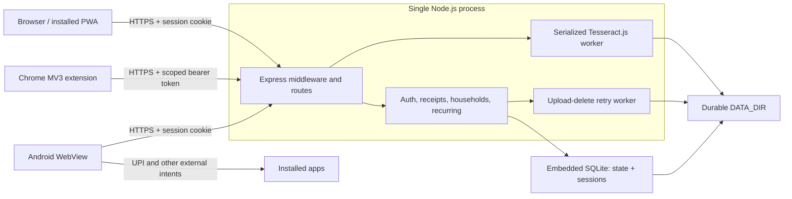
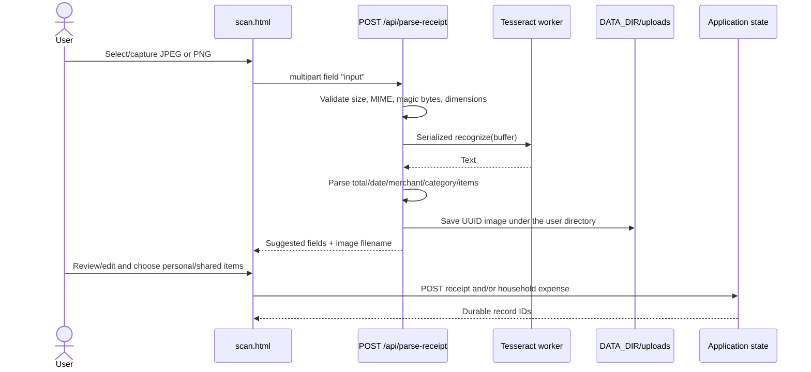

# MoneyMinder architecture

This document describes the code that exists in this repository. It is not a
future-state design. Operational launch requirements that are not implemented
in code are tracked separately in
[Production Readiness](../PRODUCTION-READINESS.md).

## System boundary

MoneyMinder is one server-rendered/static web application with two companion
clients:

- an Express server owns authentication, validation, business rules, OCR,
  persistence, and static-file delivery;
- vanilla HTML/CSS/JavaScript pages use the same-origin JSON API;
- a Manifest V3 Chrome extension uses a narrowly scoped bearer token;
- a single-activity Android app hosts the same web application in a hardened
  `WebView` and hands validated receipt selection and external-payment actions
  to Android.

There is no separate frontend build, message broker, payment processor, cloud
OCR service, or client-side source of truth.



Production is intentionally one Node application process with embedded SQLite,
local OCR, and one durable `DATA_DIR`. SQLite serializes application-state
writes, while receipt quotas, OCR, recurring work, cleanup, and rate limits are
also process-local. Horizontal replicas are not supported without redesigning
those coordination boundaries and shared receipt storage.

The checked-in OCI pilot package therefore runs one application container and
host-level Caddy; there is no database or OCR container. SQLite is auto-created
inside the attached durable volume. A public launch still needs an always-on
host, durable disk, controlled DNS/HTTPS origin, monitoring, and off-instance
recovery. The documented zero-cost topology is limited to a supervised pilot of
at most 30 active accounts and carries no SLA.

## Startup and shutdown

The executable entry point is [server/app.js](../../server/app.js). Importing
that module constructs the Express application; running it directly calls
`start()`.

Startup is fail-closed and ordered:

1. [server/config.js](../../server/config.js) loads `.env` without overwriting
   existing process variables, parses every setting, and enforces the
   production-only requirements.
2. [server/db.js](../../server/db.js) opens the configured SQLite file.
3. `db.init()` creates/checks the durable data directory, creates the database
   when absent, and applies ordered SQLite migrations.
4. [server/auth.js](../../server/auth.js) loads valid extension-token digest
   metadata into the in-process admission cache.
5. [server/ocr.js](../../server/ocr.js) verifies the bundled English OCR
   model's SHA-256 checksum. The Tesseract worker itself remains lazy.
6. The hourly orphan-scan sweep starts, then the upload-deletion retry worker
   starts.
7. [server/recurring.js](../../server/recurring.js) runs recurring posting once
   and starts its six-hour interval.
8. The HTTP server begins listening.

The server does not accept requests if migration, token-cache hydration,
OCR-model verification, or orphan-sweep initialization fails. HTTP server limits
are ten-second header timeout, seventy-second request timeout, five-second
keep-alive timeout, and at most fifty headers.

`SIGTERM` and `SIGINT` stop recurring work, stop HTTP intake, allow existing
connections most of the ten-second grace period, then terminate OCR, stop the
delete worker, close the session store, and close SQLite. Remaining
connections are forcibly closed if graceful HTTP shutdown does not finish in
time.

## Configuration

The canonical example is [.env.example](../../.env.example); parsing and
production invariants live in [server/config.js](../../server/config.js).

| Variable | Default | Role and enforced constraint |
| --- | --- | --- |
| `NODE_ENV` | unset | Exactly `production` enables production checks, HSTS, structured request logging, and secure cookie defaults. |
| `PORT` | `3000` | Integer from 1 through 65535. |
| `LISTEN_HOST` | `127.0.0.1` | Only literal loopback is accepted, keeping the raw Node port private behind the same-host TLS reverse proxy. |
| `SESSION_SECRET` | random per boot outside production | Production requires at least 32 bytes. A development process without it logs users out after restart. |
| `APP_ORIGIN` | local server origin outside production | Exact origin used to authorize browser mutations. Production requires an HTTPS origin with no path. |
| `EXTENSION_ORIGIN` | empty | Exact `chrome-extension://` origin allowed by production CORS. Omitting it disables production extension access. |
| `REGISTRATION_ENABLED` | true outside production; false in production | Controls `POST /api/register` and whether `/register.html` is served. |
| `TRUST_PROXY` | `0` outside production; `loopback` required in production | Production requires a same-host TLS reverse proxy because Node does not terminate TLS. `loopback` trusts that proxy for client IPs and secure-cookie handling; production rejects `0`, numeric hop counts, and broader trust modes. The Node port must not be reachable by untrusted clients. |
| `SESSION_COOKIE_SECURE` | follows production | Production refuses to start when false. |
| `DATA_DIR` | repository `data/` | Holds SQLite and uploads. Production requires an explicit absolute durable path. |
| `SQLITE_FILE` | `DATA_DIR/moneyminder.sqlite3` | SQLite main-file path. Production values must be absolute and resolve strictly inside `DATA_DIR`. The file and schema are created automatically. |
| `DATA_MAX_BYTES` | 25 MiB | Maximum serialized application-state size. Growing writes above the limit fail; shrinking writes remain possible. |
| `UPLOAD_TOTAL_MAX_BYTES` | 4 GiB | Global receipt-image ceiling for the supported shared volume. |
| `UPLOAD_TOTAL_MAX_FILES` | 10,000 | Global receipt-image file ceiling. |
| `APP_TIME_ZONE` | `Asia/Kolkata` | Calendar boundary used by dashboard months, date defaults, and recurring posting. Read when [server/time.js](../../server/time.js) loads. |

Configuration objects are frozen after validation. Legacy datastore settings
fail closed instead of silently selecting another backend.
Deployment secrets are not injected into public assets.

### Supported launch envelope

The reviewed zero-cost deployment is a controlled pilot, not an unrestricted
public-scale claim:

| Boundary | Supported ceiling |
| --- | ---: |
| Active pilot accounts | 30 |
| Application replicas | 1 |
| Serialized application state | 25 MiB |
| Receipt files globally | 10,000 |
| Receipt bytes globally | 4 GiB |
| Receipt files/bytes per account | 200 / 100 MiB |
| OCR admission | 1/account/minute and 2/process/minute |

These are configuration and policy ceilings, not load-test results. SQLite
write serialization, the single OCR worker, process-local rate limits, or host
resources may bind earlier. Capacity beyond this envelope requires measured
load tests and an architecture review.

## HTTP request pipeline

Middleware order in [server/app.js](../../server/app.js) is security-relevant:

1. Disable `X-Powered-By`.
2. Accept or generate an `X-Request-ID`; incoming IDs must match
   `[A-Za-z0-9._:-]{1,80}`.
3. Set `nosniff`, frame denial, same-origin referrer policy, CSP, and `no-store`
   on API responses. Production also sets HSTS and emits one structured
   completion log without request bodies or credentials.
4. Apply a per-process, per-IP fixed-window limit of 600 API requests per
   minute and a 64 KiB JSON-body limit.
5. Answer extension CORS preflights only for an allowed extension origin.
6. Expose liveness/readiness endpoints.
7. Reject unauthorized mutation origins before authentication.
8. Decode the session cookie.
9. Apply auth-specific limits and serve register, login, and logout.
10. Require a valid session or bearer token for every remaining API route.
11. Constrain bearer tokens to the extension route allowlist.
12. Mount account, OCR, receipt, and household routes.
13. Serve static files from `public/`.
14. Translate known operational errors into bounded JSON errors; unexpected API
    errors become `{"error":"Something went wrong"}`.

The mutation-origin policy is the browser CSRF boundary:

- an `Origin` header must equal `APP_ORIGIN` or the allowed extension origin;
- a request without `Origin` is accepted in production only when it carries
  `Authorization: Bearer <token>`, where `<token>` is exactly 64 lowercase
  hexadecimal characters;
- safe methods (`GET`, `HEAD`, `OPTIONS`) bypass this mutation check.

The extension CORS response allows only `GET`, `POST`, and `OPTIONS`, and the
`Content-Type`, `Authorization`, `X-Client`, and `Idempotency-Key` headers. It
does not allow credentials.

Rate limiting is deliberately process-local. Specific limits are:

| Surface | Limit |
| --- | --- |
| All `/api` traffic | 600/minute/IP |
| Register or login | 60/minute/IP and 10/minute/normalized username |
| Logout | 30/minute/IP |
| Well-shaped bearer authentication attempts | 60/minute/IP for all; 180/minute/process for digests absent from the known-token admission cache |
| Profile update | 30/minute/account |
| Export or account deletion | 10/minute/account |
| OCR upload | 1/minute/account and 2/minute/process |
| Household join | 10/minute/account and 20/minute/IP |
| Readiness endpoints | 120/minute/IP |

The limiter retains at most 10,000 active keys. A multi-process deployment
would multiply these limits and therefore needs a shared limiter.

## Authentication and authorization

Authentication behavior is in [server/auth.js](../../server/auth.js).

### Browser sessions

Passwords are validated at 15 or more Unicode code points and at most 72 UTF-8
bytes, then hashed with bcrypt cost 10. Login performs a dummy bcrypt comparison
for unknown users to reduce username timing disclosure.

Browser login regenerates the session and stores the normalized user key plus
the user's random `authVersion`. The cookie:

- is named `__Host-moneyminder.sid` in production;
- is `HttpOnly`, `SameSite=Lax`, path `/`, and secure in production;
- rolls its thirty-day lifetime on authenticated activity;
- is held in SQLite's `user_sessions` table.

The SQLite session store prunes expired rows and persists login across a clean
application restart. Every authenticated request still verifies that the
stored `authVersion` matches the current user.

### Extension bearer tokens

Login or registration with `X-Client: extension` returns a 32-byte random token
encoded as exactly 64 lowercase hexadecimal characters instead of creating a
browser session. Only its SHA-256 digest is stored. The authorization value must
match `Bearer [a-f0-9]{64}` exactly; malformed bearer syntax returns 401 without
loading application state.
Tokens expire after thirty days, carry the user's current `authVersion`, and
are capped at five per account. Issuing a token also removes expired tokens.

After database initialization, `initializeTokenCache()` creates a copy-on-write
in-process map containing only unexpired digests whose user and `authVersion`
still exist. The per-IP bearer limiter applies to every token; this cache lets a
known token bypass only the additional process-global budget reserved for
unknown-token floods. It is admission metadata, not authorization: protected
requests still load application state and validate the digest, user, expiry,
and auth version. Issue, revocation, account deletion, successful
authentication, and cache expiry replace or remove entries so restart and
runtime behavior stay aligned.

Bearer scope is enforced after authentication:

- `GET /api/summary`
- `GET /api/households`
- `POST /api/receipts`
- `POST /api/households/<UUIDv4>/expenses`

All other protected routes return 403 for a bearer token. Account updates,
exports, deletion, receipt images, OCR, household detail, settlement, and
recurring management therefore require a browser session. Bearer logout revokes
the presented digest; a 401 in the extension also removes the local token.

### Authorization rules

Resources are always selected through `req.userKey`. Missing household
membership and inaccessible resource IDs normally return 404 to avoid exposing
their existence. Mutating handlers re-check `authVersion` inside the datastore
write transaction, preventing a request authenticated before account deletion
from committing afterward.

## Persistence model

All domain state has this logical top-level shape:

```text
users
receipts
households
expenses
settlements
tokens
pendingUploadDeletes (created only while filesystem deletion is pending)
```

Values are maps keyed by username, UUID, or token digest. Recurring definitions
are nested inside their household. Migration
[001_app_state.sql](../../server/migrations/001_app_state.sql) stores this
object as JSON in the single `app_state(id=1)` row and creates the separate
`user_sessions` table in the same SQLite database.

[002_promotions.sql](../../server/migrations/002_promotions.sql) separately
creates bounded scheduled `promotion_campaigns`, per-campaign UTC
`promotion_daily_metrics`, and hashed `promotion_event_dedup` retry receipts.
That optional capability is disabled by default and its tables do not normalize
users, receipts, households, expenses, settlements, recurring bills, tokens, or
the upload-deletion outbox.

### Embedded SQLite

[server/db.js](../../server/db.js) uses Node's built-in `node:sqlite`; there is
no database package, daemon, connection URL, or account to provision. Each
`db.update(fn)` is serialized and runs as one SQLite write transaction. It
loads and parses the current `app_state` JSON, passes an isolated mutable value
to the domain callback, enforces the configured serialized-byte ceiling,
updates only when state changed, and commits. A callback failure rolls the
transaction back. Bounded lock contention is returned as `DB_BUSY`.

This keeps multi-step domain changes atomic but deliberately allows only one
application writer. The supported launch topology is one process and one
database file; adding replicas, a network filesystem, or multiple independent
writers is an architectural migration, not a deployment toggle.

[server/migrations.js](../../server/migrations.js) lexically orders `.sql`
files, creates `schema_migrations`, and applies each unapplied migration in a
transaction. Application startup runs this automatically; `npm run migrate`
provides an explicit migration-only process.

The datastore module itself does not schedule backups. The checked-in
[OCI operator package](../../deploy/oci/README.md) briefly stops the app and
uses the immutable application image to run:

```text
node server/sqlite-maintenance.js backup \
  /source/moneyminder.sqlite3 /snapshot/database.sqlite3
```

The maintenance command uses SQLite's backup mechanism and integrity checks;
the operator script never copies a live main/WAL/SHM set. It archives uploads,
records a manifest and SHA-256 inventory, encrypts the recovery set, restarts
and health-checks the app, optionally uploads the ciphertext, and only then
prunes validated local artifacts at the 30-day boundary.

`restore-drill.sh` invokes the corresponding command only in guarded isolation:

```text
node server/sqlite-maintenance.js restore \
  /restore-input/database.sqlite3 /restore-output/moneyminder.sqlite3
```

Restore creates a new database rather than overwriting its input, checks
integrity/schema, clears sessions and extension tokens, and rotates active
users' `authVersion` before the result can serve. The application still has no
point-in-time recovery, HA, or unattended scheduler; operators must execute,
monitor, and rehearse this package and reconcile deletions newer than the
selected recovery point.

## Receipt and OCR lifecycle

Receipt scanning is a two-call workflow; OCR does not create a receipt record.



[server/ocr.js](../../server/ocr.js) accepts one multipart field named `input`.
Multer caps the request at one file and 5 MiB with no form fields. The handler
requires an image MIME type, JPEG/PNG signatures, decodable header dimensions,
at most 8,192 pixels on either axis, and at most 16 million pixels.

OCR uses one lazy, reusable Tesseract.js worker and the bundled,
checksum-verified English model. Recognition is serialized. At most five
requests can be pending/in flight; later work fails as `OCR_BUSY`. Worker
initialization and recognition each have a thirty-second bound. A recognition
timeout terminates and resets the worker.

The parser examines at most 50,000 characters. It normalizes common Indian and
ISO date formats, prioritizes labeled totals, conservatively extracts at most
thirty line items, guesses a category, and detects a payment-method word. These
are suggestions: the browser requires review before the second API call.

Images are stored under `DATA_DIR/uploads/<normalized-user-key>/<UUID>.jpg|png`.
Limits are 200 files and 100 MiB per account, plus the configurable global
limits. The quota check and save are serialized with the supported single
process. An OCR image not referenced by a saved receipt is an orphan. An hourly
worker and the next-upload path both queue unreferenced files older than 24
hours for durable deletion.

Saving a receipt verifies that its image still exists. Multiple personal line
items may reference the same image. Deleting the final referencing receipt
queues the image; earlier deletions preserve it.

## Money, budgets, and household accounting

Money validation and allocation live in [server/money.js](../../server/money.js).
Boundary input is a non-negative decimal with at most two fractional digits.
Individual amounts are capped at ₹1 crore. Business records that represent
spending require a value greater than zero; budgets may be zero.

Computation converts rupees to integer paise. `allocatePaise()` deduplicates the
split member list, divides with integer arithmetic, and assigns remainder paise
deterministically before placing the payer last in remainder order. Aggregates
must remain safe JavaScript integers.

The monthly dashboard in [server/api.js](../../server/api.js) combines:

- the user's own receipt amounts in the current configured-time-zone month;
- that user's allocated share of household expenses in the same month.

It returns personal, shared, total, and category values. `dailyBudget` is the
monthly budget divided by days in the current month; `onTrack` compares
cumulative spend with `dailyBudget × current day`. Insights return the same
current-month category totals plus a fourteen-day daily series.

[server/households.js](../../server/households.js) computes household net values:

1. credit an expense's payer by the full amount;
2. debit each selected member by their exact paise allocation;
3. apply only confirmed settlements, crediting the payer and debiting the
   recipient;
4. greedily match the largest debtors with largest creditors to produce a
   simplified `owes` list.

Positive net means the household owes that member; negative means the member
owes the household. A settlement is only an application ledger proposal.
`method: "upi"` causes the web client to create a UPI deep link; MoneyMinder
does not move money or verify a bank transaction. The recipient must confirm
the pending settlement before balances change.

Hard domain ceilings are:

| Entity | Per account | Per household |
| --- | ---: | ---: |
| Receipts | 1,000 | n/a |
| Household memberships | 20 | 50 active members |
| Expenses | 1,000 created by the account | 1,000 |
| Recurring definitions | 200 created by the account | 100 |
| Settlements | 1,000 created by the account | 1,000 |

Lists have no pagination because these ceilings bound their size.

## Idempotency and recurring work

Create-style browser and extension operations may send `Idempotency-Key`.
[server/http.js](../../server/http.js) accepts 16–80 characters from
`A-Za-z0-9._:-`. Receipt, household, expense, settlement, and recurring
creation store the key with actor scope. Repeating the same key and equivalent
input returns the existing object/ID; reusing it for different input returns
409. Operation keys are stripped from API views and data exports.

The clients retain a generated key while a form body is unchanged, which makes
retry after a lost response safe. The receipt line-item UI additionally marks
each completed row so a partial multi-request save resumes only unsaved rows.

Recurring definitions allow days 1–28. [server/recurring.js](../../server/recurring.js)
runs on boot and every six hours. Once the configured local day reaches the
definition's day, it posts a normal expense paid by the active household owner
(or first active member) and records `lastPostedYM`. That monthly marker makes
repeated runs idempotent. The worker stops posting when the payer or household
expense ceiling is reached; it retries eligible unposted definitions on a later
run.

## Deletion and filesystem outbox

Account deletion requires a browser session and current-password
reauthentication. [server/auth.js](../../server/auth.js) performs one atomic
state change:

- remove the user, personal receipts, and bearer tokens;
- remove households with no remaining active member and their ledger records;
- replace the departing member in retained shared records with a random,
  non-login `deleted-<UUID>` identifier;
- transfer household ownership to an active member where possible;
- rotate affected household join codes;
- queue deletion of the user's upload directory.

The retained pseudonymous expense, recurring, and settlement records preserve
other members' balances. API views label the alias `Deleted member` and do not
expose it as an active member key.

[server/uploads.js](../../server/uploads.js) stores filesystem work in the
state object's `pendingUploadDeletes` outbox before deleting files. A retry
worker drains it immediately and then with exponential delay up to one minute.
It revalidates every path and refuses to delete an image that became referenced
again or a user directory whose account exists. A username with a pending
directory deletion cannot be re-registered.

Account deletion removes the user's SQLite session rows and destroys the
current session in the same logical workflow. The application cannot rewrite
previously encrypted recovery sets, so the OCI workflow requires a separate
deletion register, reconciliation before production restore, and 30-day expiry
for local, OCI, and off-tenancy copies; alternate backup providers need
equivalent controls.

## Public web application and PWA

The web client under [public/](../../public) is multi-page HTML with shared
scripts:

- [public/js/api.js](../../public/js/api.js) provides same-origin fetch,
  error handling, escaping, formatting, and browser-side idempotency keys;
- [public/js/nav.js](../../public/js/nav.js) renders the bottom navigation;
- [public/js/charts.js](../../public/js/charts.js) renders accessible inline SVG
  charts without a chart dependency;
- [public/js/pwa.js](../../public/js/pwa.js) registers the service worker;
- [public/js/onboard.js](../../public/js/onboard.js) provides local-only,
  one-time onboarding;
- [public/js/toast.js](../../public/js/toast.js) provides accessible transient
  status messages.

[public/sw.js](../../public/sw.js) precaches the application shell. Static
assets are cache-first; navigations are network-first with a cached page/index
fallback. API GETs are network-first and never cached; offline API access
returns an explicit 503 JSON error. The installed shell can therefore launch
offline, but account data and mutations require the server.

The server CSP permits only self-hosted resources and data images, blocks
objects, frames, foreign bases, and foreign form actions. It currently includes
`'unsafe-inline'` for scripts and styles because the HTML pages contain inline
application code and style attributes. Removing that allowance requires moving
those blocks to static files or introducing nonces.

## Chrome extension

The extension is defined by [extension/manifest.json](../../extension/manifest.json)
and has four runtime roles:

- [extension/popup.js](../../extension/popup.js) authenticates, renders summary
  and household balance data, creates expenses/receipts, and manages opt-in;
- [extension/detect.js](../../extension/detect.js) is a pure purchase detector;
- [extension/content.js](../../extension/content.js) reads eligible HTTPS pages
  locally after opt-in;
- [extension/background.js](../../extension/background.js) keeps per-tab
  candidates and toolbar badges.

Detection is off by default. Enabling it requests optional `https://*/*`
permission, registers the content scripts, and records the preference. The
content script first reads schema.org `Order`/`Invoice` JSON-LD. It bulk-reads
visible text only when the URL already resembles an order, receipt, or
confirmation page. It emits only amount, INR classification, merchant,
category guess, and source to extension session storage. Page contents are not
sent to the server.

A detection is not a transaction. Only pressing **Track** creates a personal
receipt via the scoped API. Candidates and their retry keys use
`chrome.storage.session`; the bearer token and server origin use
`chrome.storage.local`, whose access level is restricted to trusted extension
contexts. Disabling detection unregisters scripts and removes optional page
access.

[scripts/package-chrome.mjs](../../scripts/package-chrome.mjs) builds the store
ZIP from an explicit runtime-file allowlist. It requires a public HTTPS DNS
origin with no port/path/query/fragment, rewrites the manifest's API host
permission and popup default, creates the archive with its manifest at the
root, normalizes archive timestamps for reproducibility, and removes staging.
The operator then runs
[scripts/verify-release-artifact.mjs](../../scripts/verify-release-artifact.mjs)
against that exact ZIP. It rejects unsafe, duplicate, missing, or extra entries;
requires the exact Manifest V3 permission set, packaged host permission, and
popup origin; and prints a SHA-256 that can be required on re-verification.

## Android wrapper

[MainActivity.kt](../../android/app/src/main/java/com/moneyminder/app/MainActivity.kt)
is a single `WebView` activity. There is no JavaScript interface or duplicate
native business model.

The release backend origin is baked into a string resource by
[android/app/build.gradle.kts](../../android/app/build.gradle.kts). Release
validation requires a real public HTTPS DNS origin; release network security
also disables all cleartext traffic. Debug builds use
`http://10.0.2.2:3000` and a debug-only allowlist for local hosts.

The wrapper:

- enables JavaScript and DOM storage for the existing web app;
- accepts first-party cookies and disables third-party cookies;
- disables direct file/content access and extra WebView windows;
- keeps only the exact configured scheme/host/effective-port in the WebView;
- sends only user-initiated main-frame `https`, `upi`, `tel`, `sms`, `mailto`,
  and `whatsapp` navigation to browsable Android `ACTION_VIEW` intents;
- consumes script/subframe, cleartext external HTTP, `intent:`, `market:`,
  malformed, and unknown-scheme navigation without external dispatch;
- replaces HTML file selection/capture requests with Android's single-item
  content picker and admits only one readable JPEG/PNG `content:` URI;
- requests no camera/media permission and denies WebView device permissions;
- applies system-bar/display-cutout insets on all four edges and zeroes the
  handled insets before dispatching them to WebView;
- has no orientation lock and explicitly supports resizable/large-screen
  windows;
- routes hardware Back through WebView history.

Release output is minified and signed with the operator's upload key.
`keystore.properties` and the keystore are excluded from source control.
The exact AAB must then pass `verify-release-artifact.mjs android`: the verifier
requires the expected upload-certificate fingerprint, extracts that single
public certificate into an ephemeral PKCS12 truststore for strict `jarsigner`
verification, checks the pinned bundletool JAR digest, runs `bundletool
validate`, proves compiled `string/server_url` equals the intended HTTPS origin,
and emits the AAB digest. The truststore never contains the upload private key.

## Build and verification pipeline

[package.json](../../package.json) pins the npm toolchain and exposes:

- manifest parsing and JavaScript syntax checks;
- unit/integration/E2E tests;
- 80% minimum line, function, and branch coverage;
- real SQLite restart and write-serialization integration;
- Chrome package creation.

[.github/workflows/verify.yml](../../.github/workflows/verify.yml) additionally
runs an OSV lockfile scan, npm audit, SQLite integration, a pinned production
container build/smoke/shutdown and closed-enrollment probe, exact
verification of the compile-only Chrome ZIP, Android URL/signing/platform
validators, Android lint, APK compilation, and AAB compilation. CI uses
disposable Android signing and compile-only public origins. Its Android and
Chrome outputs prove buildability; they are not publishable artifacts.

The Docker image runs as the unprivileged `node` user, exposes the durable data
directory as a volume, and uses `/readyz` for health. The pinned Node image
digest is checked against the registry, and the workflow contains a dated guard
that forces repinning after the announced July 2026 Node security release.

## Trust boundaries and failure modes

| Boundary or failure | Control and observable behavior |
| --- | --- |
| Browser input | Schema-like route validation, money/date/length ceilings, 64 KiB JSON cap; returns 400/413. |
| Cross-site mutation | Exact-origin check before auth; production originless session mutations fail 403. |
| Extension access | Exact production extension origin, cookieless CORS, hashed scoped tokens, optional page access. |
| Resource ownership | User key and household membership checks; inaccessible IDs generally return 404. |
| Receipt files | Magic-byte/dimension validation, per-user directories, basename/path checks, authenticated delivery, byte/file quotas. |
| OCR exhaustion | Per-user/process rate limits, one bounded worker, bounded queue; busy returns 503 with `Retry-After: 30`. |
| State contention | Serialized SQLite write transactions with a bounded wait; temporary contention returns 503. |
| State/upload capacity | Growing state or new images fail 507; deletion remains available. |
| Database outage | `/readyz` and `/healthz` return 503; readiness results are cached for two seconds. `/livez` still reports process liveness. |
| Partial filesystem deletion | Durable outbox retries; data record deletion is not rolled back merely because file removal failed. |
| Duplicate client retry | Idempotency keys replay an equivalent create and reject conflicting reuse. |
| OCR/model corruption | Startup checksum verification prevents the server from listening. |
| External payment | UPI is an unverified external intent; balances change only after in-app recipient confirmation. |
| Offline PWA | Shell may render, but uncached API calls return an explicit offline 503 and mutations cannot proceed. |

## Safe extension points

Prefer existing boundaries:

- add an API route in the owning domain module and mount it through
  [server/app.js](../../server/app.js), preserving origin, auth, scope, and
  `asyncRoute` ordering;
- add a domain mutation inside one `db.update()` callback so authorization,
  idempotency, quota checks, and writes stay atomic;
- add migrations as lexically ordered SQL files without modifying an applied
  migration;
- add a client feature to the existing page that owns its workflow and add any
  new shell asset to [public/sw.js](../../public/sw.js);
- add extension access only by updating both CORS expectations and the bearer
  allowlist, then documenting why the added scope is necessary;
- add Android-native behavior only when the web platform cannot provide it, and
  keep navigation/permission checks tied to the configured origin.

Changes that require an architectural migration rather than another helper are:
multiple application replicas, independently scalable OCR, unbounded history or
analytics, provider-verified payments, non-INR accounting, and offline data
mutation/synchronization.
