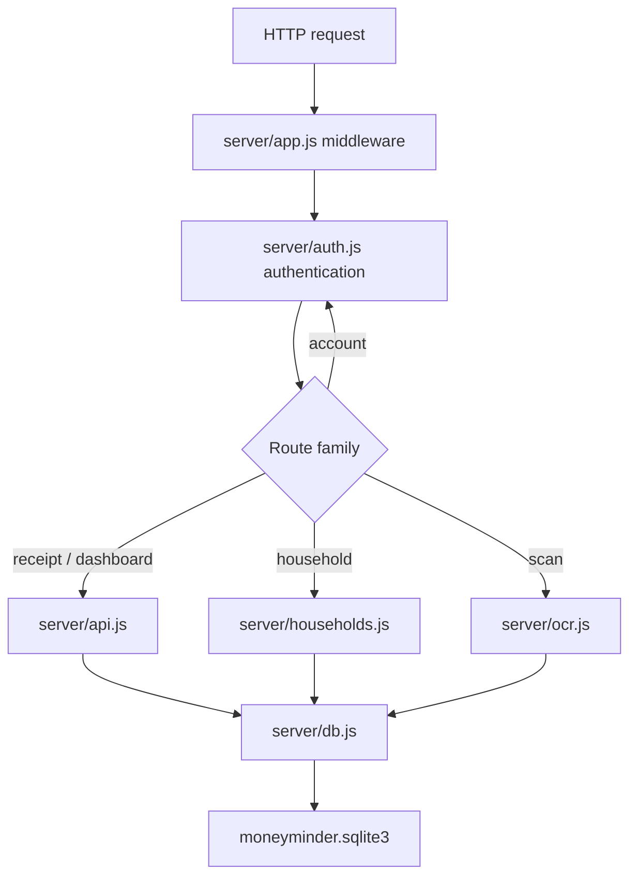

# MoneyMinder codebase guide

This is the implementation map for maintainers and coding agents. Read
[Architecture](ARCHITECTURE.md) for runtime relationships and
[API Reference](API-REFERENCE.md) before changing a route contract.

## Fast orientation

MoneyMinder is deliberately small:

```text
server/          Node.js/Express API, domain rules, OCR, and persistence
public/          Static multi-page web/PWA client
extension/       Chrome Manifest V3 companion
android/         Kotlin WebView wrapper and Gradle release project
scripts/         Release packaging utilities
deploy/oci/      Controlled-pilot SQLite/uploads backup and restore drill
test/            Cross-surface release/readiness tests
store-listing/   Play and Chrome listing text plus generated assets
docs/            Product, engineering, operations, and release material
.github/         CI verification
```

There is no frontend compilation step. Editing a file under `public/` changes
what Express serves. The Android wrapper loads that same deployed site; the
extension calls the same API.

## Module ownership map

| File or directory | Owns | Does not own |
| --- | --- | --- |
| [server/app.js](../../server/app.js) | Express construction, middleware ordering, headers, CORS/origin policy, rate limits, route mounting, health, startup/shutdown, error mapping | Domain validation and calculations |
| [server/config.js](../../server/config.js) | `.env` parsing, defaults, production startup invariants | Runtime secret storage or deployment provisioning |
| [server/auth.js](../../server/auth.js) | Registration/login/logout, browser sessions, extension tokens, profile/export/deletion | Generic route mounting or household math |
| [server/http.js](../../server/http.js) | Async Express adapter, idempotency-header syntax, in-transaction auth-version check | HTTP server setup |
| [server/api.js](../../server/api.js) | Personal receipts, image delivery, budget summary, insights, category mapping | OCR recognition and household ledgers |
| [server/households.js](../../server/households.js) | Household membership, expenses, balances, settlement, recurring-definition CRUD | Recurring scheduler |
| [server/recurring.js](../../server/recurring.js) | Due-date test, scheduled posting, six-hour loop | API route definitions |
| [server/money.js](../../server/money.js) | Money boundary parsing, paise conversion/addition/allocation | Display formatting |
| [server/time.js](../../server/time.js) | Configured-zone calendar keys and strict date validation | Duration/time-zone conversion APIs |
| [server/ocr.js](../../server/ocr.js) | OCR model verification, worker queue, image validation/save, receipt text heuristics | Durable receipt creation |
| [server/uploads.js](../../server/uploads.js) | Safe upload paths and durable deletion outbox/retry | Upload recognition or receipt ownership |
| [server/db.js](../../server/db.js) | Embedded SQLite connection, serialized application-state transactions, readiness, and lifecycle | Domain schema normalization |
| [server/migrations.js](../../server/migrations.js) | Ordered SQLite migration discovery and application ledger | Domain data migration helpers |
| [server/sqlite-maintenance.js](../../server/sqlite-maintenance.js) | Integrity-checked backup and credential-sanitizing restore | Scheduling, encryption, or off-instance retention |
| [public/](../../public) | Browser UI, PWA shell, same-origin interactions | Security-critical business decisions |
| [extension/](../../extension) | Popup client and opt-in page purchase detection | Broad account administration or automatic expense creation |
| [android/](../../android) | Trusted-origin WebView, validated receipt picker, target-36 insets, external intents, signed Android build | Duplicate business logic |
| [scripts/package-chrome.mjs](../../scripts/package-chrome.mjs) | Deterministic release ZIP and production-origin rewrite | Web Store submission |
| [scripts/verify-release-artifact.mjs](../../scripts/verify-release-artifact.mjs) | Exact Chrome ZIP and Android AAB identity, origin, permission, signature, signer, tool, and digest gates | Building, signing, or uploading an artifact |
| [deploy/oci/](../../deploy/oci) | One-container OCI topology, encrypted SQLite/uploads backup, retention verification, and isolated restore drill | HA, point-in-time recovery, or unattended operator scheduling |
| [.github/workflows/verify.yml](../../.github/workflows/verify.yml) | Reproducible CI gates and compile-only artifacts | Operator credentials or publishing |

## Runtime data records

These are JavaScript objects, not exported TypeScript types. Treat the source
constructors as authoritative.

### User

Created in [server/auth.js](../../server/auth.js), keyed by normalized lowercase
username:

```js
{
  username, email, mobile,
  budget,                 // rupees; zero allowed
  vpa,                    // optional UPI VPA
  displayName,
  passwordHash,
  authVersion,            // random UUID used to invalidate auth
  createdAt               // ISO timestamp
}
```

Public user views omit `passwordHash`, `authVersion`, and `createdAt`.

### Receipt

Created in [server/api.js](../../server/api.js), keyed by UUID:

```js
{
  id, userKey, category, date, amount,
  supplier, document, image, createdAt,
  operationKey?           // stored for retry safety, never exposed
}
```

`image` is only a filename. Its owner directory comes from `userKey`.

### Household and recurring definition

Created in [server/households.js](../../server/households.js):

```js
{
  id, name, code, ownerKey, members, createdAt,
  operationKey?,
  recurring?: [{
    id, description, amount, category,
    splitAmong,            // array or null meaning active members at posting
    dayOfMonth, lastPostedYM, createdBy,
    operationKey?
  }]
}
```

Join codes are six characters drawn from an alphabet that excludes ambiguous
`0/O/1/I`.

### Expense

```js
{
  id, householdId, paidBy, description, amount,
  category, splitAmong, date, createdAt,
  recurringId?, operationKey?
}
```

The payer need not be in `splitAmong`. `splitAmong` is deduplicated and limited
to active household members when the expense is created.

### Settlement

```js
{
  id, householdId, from, to, amount,
  method,                  // "cash" or "upi"
  status,                  // initially "pending", then "confirmed"
  confirmedAt, date, createdAt, operationKey?
}
```

A pending settlement does not affect balances.

### Extension token

Keyed by a SHA-256 token digest:

```js
{ userKey, authVersion, createdAt }
```

The raw token exists only in the login response and trusted extension storage.
After database initialization, the server seeds an in-process map with only
currently valid digest metadata. That map lets known tokens bypass the
process-global unknown-token flood budget after the per-IP limit; it is not an
authorization cache. `requireAuth` still loads current state and validates the
digest, user, expiry, and `authVersion`, while issue/revocation/deletion replace
the map through copy-on-write updates.

### Upload deletion task

The optional `pendingUploadDeletes` map is keyed by UUID:

```js
{ kind: "image", userKey, name }
{ kind: "user", userKey }
```

Do not delete files directly from a domain handler. Queue the task in the same
state transaction that removes its logical reference.

## Request-to-code map



Route handlers do not catch promises themselves. Mount them with
`asyncRoute()` so errors reach the centralized error mapper. Do not place a new
protected route before `auth.requireAuth`, and do not assume authentication
alone grants extension bearer scope.

## Important end-to-end flows

### Registration and login

1. [public/register.html](../../public/register.html) or
   [public/login.html](../../public/login.html) posts credentials through
   `window.API`.
2. The app applies global/auth rate limits before bcrypt work.
3. Registration validates all account fields, hashes the password, and writes
   the user atomically.
4. Browser clients receive a regenerated cookie session. An extension request
   carrying `X-Client: extension` receives a bearer token instead.
5. Every later authenticated request reloads the user and compares
   `authVersion`.

Registration is closed by default in production. When closed, both the API and
the registration page are unavailable.

### Personal receipt

Manual entry can post directly to `POST /api/receipts`. Scanning first posts the
image to `POST /api/parse-receipt`, lets the user correct suggestions, then
posts the durable receipt. The temporary image becomes durable only by being
referenced from a receipt record.

When OCR finds line items, [public/scan.html](../../public/scan.html) lets each
item be assigned to **Mine** or **Shared**. Personal rows become receipts;
shared rows become household expenses. Each row has its own idempotency key and
completion marker so retries resume after the first failed row.

### Dashboard

[public/index.html](../../public/index.html) concurrently loads summary,
insights, receipts, and household list. Server code calculates values from
current records; the client never submits a total or balance.

### Household and settlement

[public/household.html](../../public/household.html) creates or joins a
household, loads detail and recurring definitions, and posts expenses.
`computeBalances()` derives every net and the simplified debt graph.

For UPI, the page constructs `upi://pay` from the creditor's stored VPA and the
selected debt. Android/another browser hands that URI to an installed payment
app. MoneyMinder subsequently records a pending settlement request. The
creditor confirms it in MoneyMinder; only that confirmation affects balances.
There is no callback from the payment provider.

### Account deletion

[public/profile.html](../../public/profile.html) requires password entry and a
destructive confirmation. The server removes private records, pseudonymizes
shared ledger references, rotates household codes, invalidates auth, and queues
filesystem deletion. See [Architecture](ARCHITECTURE.md#deletion-and-filesystem-outbox)
before changing this path; it deliberately preserves group accounting.

## Public page map

| Page | Purpose | Principal APIs |
| --- | --- | --- |
| [login.html](../../public/login.html) | Browser authentication | `POST /api/login` |
| [register.html](../../public/register.html) | Controlled account enrollment | `POST /api/register` |
| [index.html](../../public/index.html) | Budget overview and charts | summary, insights, receipts, households |
| [scan.html](../../public/scan.html) | OCR/manual receipt capture and item assignment | parse-receipt, receipts, households, expenses |
| [receipts.html](../../public/receipts.html) | Personal receipt list | receipts |
| [receipt.html](../../public/receipt.html) | Receipt detail/image/delete | one receipt, image, delete receipt |
| [household.html](../../public/household.html) | Group creation, ledger, UPI/cash settlement, recurring bills | household route family |
| [profile.html](../../public/profile.html) | Profile, export, deletion, logout | account route family |
| [privacy.html](../../public/privacy.html) | Public policy template/content | none |
| [delete-account.html](../../public/delete-account.html) | External deletion instructions | none |
| [pilot.html](../../public/pilot.html) | Shareable pilot proposition | none |
| [demo.html](../../public/demo.html) | Static, unauthenticated product demonstration | none |

All pages use escaped user text when building HTML strings. Preserve that rule;
prefer `textContent`, or use `API.escapeHtml()` before interpolation.

## Extension code map

| File | Responsibility |
| --- | --- |
| [manifest.json](../../extension/manifest.json) | MV3 metadata, trusted API host, optional HTTPS page permission |
| [popup.html](../../extension/popup.html) / [popup.css](../../extension/popup.css) | Login, dashboard, detected-purchase disclosure and controls |
| [popup.js](../../extension/popup.js) | Trusted network/token context, optional permission lifecycle, scoped API calls |
| [detect.js](../../extension/detect.js) | Pure JSON-LD/text purchase heuristics, INR-only candidate construction |
| [content.js](../../extension/content.js) | Opt-in page inspection and candidate reporting |
| [background.js](../../extension/background.js) | Trusted storage access level, per-tab candidate/badge lifecycle |

Content scripts must never receive the bearer token. Network requests belong in
the popup/background trusted context. Purchase detection must remain advisory:
no API write occurs without the popup's explicit **Track** action.

The checked-in manifest points at localhost for unpacked development. Never
hand-edit a release copy; run `npm run package:chrome` with
`MONEYMINDER_SERVER_URL` so the package script rewrites both required places
from one validated origin. Run `scripts/verify-release-artifact.mjs chrome`
against the exact ZIP before upload; it enforces the runtime-file allowlist,
least-privilege permission set, packaged origin, and recorded digest.

## Android code map

| File | Responsibility |
| --- | --- |
| [MainActivity.kt](../../android/app/src/main/java/com/moneyminder/app/MainActivity.kt) | WebView hardening, trusted-origin navigation, validated receipt picker, target-36 insets, external intents |
| [AndroidManifest.xml](../../android/app/src/main/AndroidManifest.xml) | Network permissions, package visibility, system content picker, launcher activity |
| [release network config](../../android/app/src/main/res/xml/network_security_config.xml) | No cleartext traffic |
| [debug network config](../../android/app/src/debug/res/xml/network_security_config.xml) | Explicit local cleartext exceptions |
| [app/build.gradle.kts](../../android/app/build.gradle.kts) | SDK/version IDs, release URL validation, signing, minification, validation tasks |
| [android/RELEASE.md](../../android/RELEASE.md) | Existing Play-oriented release notes |

Keep authentication and domain behavior on the server/web side. Native code
should remain a capability adapter. There is intentionally no
`addJavascriptInterface`.

## Business invariants

### Money

- API values are decimal rupees; calculations use integer paise.
- At most two decimal places and ₹1 crore per individual value.
- Budgets may be zero; spending, expenses, recurring bills, and settlements
  must be greater than zero.
- Never use client-computed balances as input.
- Preserve deterministic remainder allocation in
  [server/money.js](../../server/money.js).

### Dates

- Stored domain dates use `YYYY-MM-DD`.
- `APP_TIME_ZONE` defines the server's current date/month.
- Recurring days stop at 28, avoiding end-of-month ambiguity.
- The extension creates a date from the browser's local calendar; the server
  validates its shape but does not rewrite it.

### Categories

Canonical dashboard buckets are `food`, `travel`, `housing`, `misc`, and
`other`. Personal receipt mapping accepts selected legacy/OCR names. Household
input outside the canonical list becomes `other`.

### Idempotency

Use one stable key per logical create operation. Generate a new key when the
body changes. Validate conflict behavior, not only duplicate-success behavior.
Never expose stored operation keys in API output.

### Authorization

Re-check `isCurrentUser()` inside every state-changing `db.update()` callback.
For household resources, test membership inside the same callback. Returning
404 for inaccessible resources is intentional.

### Immutability boundary

Most domain callbacks mutate the transaction-local state object because the
store commits that isolated object atomically. Client-facing updates and
selected household collection replacements use new objects/arrays. Do not
retain a state reference outside its `load()` or `update()` operation.

## Testing map

| Test area | Files |
| --- | --- |
| App middleware, limits, health, shutdown | [server/app.test.js](../../server/app.test.js) |
| Authentication, profile, export, deletion | [server/auth.test.js](../../server/auth.test.js) |
| Receipt/summary behavior | [server/api.test.js](../../server/api.test.js) |
| Household balances, settlement, recurring CRUD | [server/households.test.js](../../server/households.test.js) |
| OCR parsing, image validation, worker behavior | [server/ocr.test.js](../../server/ocr.test.js) |
| Recurring scheduler | [server/recurring.test.js](../../server/recurring.test.js) |
| Money/date helpers | [server/money.test.js](../../server/money.test.js), [server/time.test.js](../../server/time.test.js) |
| SQLite store/migrations/session behavior | [server/db.test.js](../../server/db.test.js), [server/migrations.test.js](../../server/migrations.test.js), [server/auth.test.js](../../server/auth.test.js) |
| Real SQLite restart and serialization path | [server/sqlite-integration.test.js](../../server/sqlite-integration.test.js) |
| Full browser-facing API journeys | [server/e2e.test.js](../../server/e2e.test.js) |
| Public HTML/service worker behavior | [public/ui.test.js](../../public/ui.test.js) |
| Extension detector/platform invariants | [extension/detect.test.js](../../extension/detect.test.js), [extension/platform.test.js](../../extension/platform.test.js) |
| Store packages/assets/readiness | [test/chrome-package.test.js](../../test/chrome-package.test.js), [test/store-readiness.test.js](../../test/store-readiness.test.js) |

Use the smallest relevant test during iteration, then run:

```text
npm run verify
npm audit --omit=dev --audit-level=low
```

For store changes also run `npm run test:sqlite`. For store-facing Android
changes, run the Gradle validation tasks documented in
[android/RELEASE.md](../../android/RELEASE.md).

## Change recipes

### Add a protected API operation

1. Choose the existing owner module.
2. Define and test boundary validation and authorization.
3. Put all state-dependent checks and changes in one `db.update()`.
4. Mount with `asyncRoute()` after the global auth middleware.
5. Decide explicitly whether extension bearer scope needs it. Default is no.
6. Add the contract to [API Reference](API-REFERENCE.md).

### Change persistent data

The core financial/account state is a schemaless JSON object stored in one
SQLite row. Code must tolerate missing optional fields from older records.
Promotions use separate, explicitly constrained tables created by
`002_promotions.sql`; those tables do not normalize the core state. If a SQL
object changes, add a new ordered migration; never rewrite an applied migration.
If domain records need a one-time transformation, make it deterministic and
retry-safe. Normalizing core entities is a future measured scaling migration,
not a compatibility adapter to add speculatively.

### Add a public asset or page

Add the file under `public/`, link it from the owning workflow, and decide
whether it belongs in the service-worker shell. Increment the cache key when
the shell changes. API data must remain uncached.

### Change OCR

Keep parser helpers pure and bounded. Add fixtures to `server/ocr.test.js`.
Do not add a network model fallback: startup checksum verification and local
processing are privacy/reproducibility guarantees.

### Change extension detection

Change pure logic in `detect.js` first, with tests. Keep `content.js` limited to
data collection and messaging. Re-run platform tests to ensure token isolation,
optional permission removal, MV3 CSP, and package allowlisting still hold.

### Add Android integration

Prefer standard intents/activity-result APIs. Validate both origin and requested
resource before granting a WebView permission. Any new release configuration
must fail closed in Gradle and have a deterministic validation task.
Before upload, run `scripts/verify-release-artifact.mjs android` on the exact
AAB to verify its artifact digest, single expected upload certificate, strict
signature, pinned bundletool, compiled server origin, and bundle validity.

## Known ceilings and non-features

These are deliberate current boundaries, not hidden promises:

- one Node process and one durable upload volume;
- one SQLite application-state row serializes all writes;
- one in-process OCR worker;
- in-process fixed-window rate limiting;
- INR only;
- English receipt OCR model;
- no password reset or email/mobile verification;
- no server-verified bank/UPI payment;
- no offline data synchronization;
- no push notifications;
- no administration dashboard;
- no normalized analytics warehouse;
- no high availability, point-in-time recovery, or unattended backup scheduler.

The supported zero-cost topology is capped at 30 active accounts, one process,
25 MiB of serialized application state, 10,000 receipt files, and 4 GiB of
receipt images. This is a controlled-pilot policy envelope, not load-test
evidence or a 10,000-user claim; SQLite serialization, OCR, rate limits, or host
resources can bind earlier.

The OCI pilot includes operator-run encrypted SQLite/uploads backup, 30-day
retention verification, and a guarded isolated restore drill under
`deploy/oci/`. These scripts remain ineffective until an operator configures
off-instance storage, runs and monitors backups, and records successful restore
rehearsals.

Do not describe roadmap documents as implemented. The current release gate and
required operator decisions are in
[Production Readiness](../PRODUCTION-READINESS.md).

## Handoff checklist for another coding agent

Before editing:

1. Read this guide, [Architecture](ARCHITECTURE.md), the affected source file,
   and its test.
2. Check `git status`; preserve unrelated and parallel work.
3. Trace the public page/extension/Android caller through the API to the domain
   write and datastore.
4. Keep trust-boundary validation server-side.
5. Reuse `money`, `time`, `http`, upload, and client API helpers instead of
   duplicating rules.

Before handing back:

1. Run the narrow test and `npm run verify`.
2. Run `git diff --check` and inspect the complete diff.
3. Update this documentation only when the real contract or ownership changed.
4. Report tests that were not runnable and the exact missing external input.
