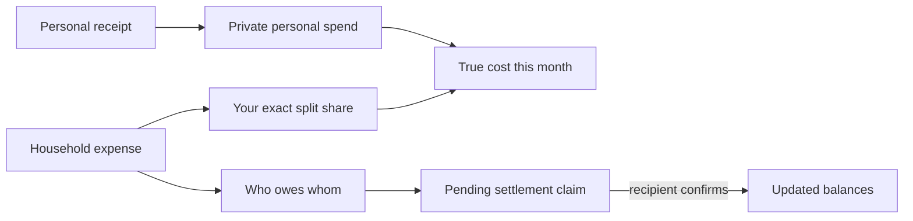

# How MoneyMinder works

This guide follows the implemented web/PWA, Android, and Chrome workflows. For
positioning, limits, and non-features, read the
[product guide](PRODUCT-GUIDE.md).

## The ledger in one picture



Settlements change balances, not historical cost. MoneyMinder never treats
returning from a UPI app as proof that money moved.

## 1. Join the pilot and sign in

1. Open the operator-provided HTTPS web address.
2. If registration is open, select **Create account** and supply username,
   email, mobile number, monthly budget, a password, and optionally a UPI ID.
3. Use a password of at least 15 characters and no more than 72 UTF-8 bytes.
4. Sign in with the username and password.
5. In **Profile**, add a display name for roommates, adjust the monthly budget,
   or add the UPI ID used when a roommate pays you.

Production registration is closed by default. An operator can open it for a
controlled enrollment window and close it without disabling existing logins.
There is no email/phone verification and no password-reset flow.

Browser sessions refresh their 30-day lifetime while the account is active.
Signing in through the Chrome extension creates a separate revocable bearer
token; it does not reuse the browser cookie.

The one supported backend process stores application state and browser sessions
in a built-in SQLite file under the operator's durable `DATA_DIR`; no separate
database service is required. The controlled release is capped at 30 active
pilot accounts.

## 2. Read the dashboard

The dashboard loads five server-backed views:

- **Your true cost this month**: personal receipts plus your allocated household
  shares;
- **Personal** and **Shared** components;
- progress against the monthly budget;
- category totals and a 14-day daily trend;
- recent personal receipts and a household settle-up callout.

The application time zone determines the current month and date buckets. It
defaults to Asia/Kolkata. The pace indicator uses:

```text
daily budget = monthly budget / days in current month
on track = true cost <= daily budget × current day number
```

The progress bar uses the full monthly budget. The dashboard's recent-activity
list shows personal receipts; shared costs are visible in Roommates and are
already included in true cost.

## 3. Capture a personal receipt

1. Select **Add an expense** or **Scan**.
2. In the web/PWA, take a photo or choose one JPEG/PNG image. In the Android
   wrapper, choose one existing JPEG/PNG image through the system picker.
3. Select **Scan receipt**.
4. Review every proposed field.
5. Correct the category, date, amount, supplier, and payment/document hint.
6. Save.

The server checks the image signature and dimensions before OCR. It uses one
bundled English model and makes no OCR API or model-download request. A scan may
wait behind another scan; the UI reports a busy response when the bounded
worker/queue cannot accept it.

If OCR cannot derive useful fields, the same screen becomes a manual form. The
scan is not a transaction until the user saves a valid amount. Recognition
failure can yield a manual record without a stored image.

After saving:

- the receipt appears only in that account's receipt list;
- its amount contributes to the receipt's month and category;
- its image is available only through an authenticated owner-scoped route;
- deleting the last record that references the image queues file deletion.

An unsaved recognized image becomes an orphan candidate after 24 hours. An
hourly server sweep queues it for deletion, and later uploads also trigger the
same check. Temporary deletion may therefore complete shortly after the
24-hour threshold rather than at an exact minute.

## 4. Route receipt line items

When OCR proposes line items, MoneyMinder shows each row as **Mine** or
**Shared**.

1. Review the item descriptions and amounts.
2. Leave personal items on **Mine**.
3. Mark common items **Shared**.
4. If any item is shared, choose one household.
5. Select **Save split**.

Each **Mine** row becomes a separate personal receipt using the scan's merchant,
date, category, image, and line description. Each **Shared** row becomes a
household expense paid by the signed-in user and split across that household's
active members.

The save loop is idempotent per row. If a network or capacity failure occurs
midway, the page reports how many rows saved; retry saves only the remaining
rows. The UI cannot route different shared rows from one scan to different
households in the same operation.

OCR reconciles proposed lines to the recognized total:

- when lines are short, it adds an **Unitemized remainder**;
- when proposed lines exceed the recognized total, it replaces them with one
  **Receipt total** row.

These are conservative heuristics. Review them.

## 5. Create or join a household

To create:

1. Open **Roommates**.
2. Enter a household name.
3. Select **Create household**.
4. Share the six-character code with intended members through a trusted
   channel.

To join:

1. Open **Roommates**.
2. Enter the code.
3. Select **Join household**.

A code is not a public identifier or security secret equivalent to a password,
but it grants entry to anyone who has a valid account and code. Account deletion
rotates codes for surviving households. The product currently has no button to
rotate a code, remove a member, leave, rename, or delete a populated household.

## 6. Add and split a household expense

1. Open the household.
2. Enter a description and amount.
3. Choose Food, Travel, Housing, Misc, or Other.
4. Select at least one active member under **Split among**.
5. Select **Add expense**.

The signed-in user is always the payer. A split member owes an allocated share
even when that person did not pay. A payer can be excluded from the split if
that is the intended ledger entry.

The category heads-up in the form is advisory. It divides the monthly budget
into five equal category slices and estimates the current user's share; it
does not block saving and is not a financial recommendation.

Shared expenses are currently append-only: there is no edit or delete endpoint.
Correct an error operationally before relying on balances; do not invent a
negative expense because amounts must be positive.

## 7. Understand exact split math

All accounting arithmetic uses integer paise. Duplicate members are removed.
For a split that does not divide evenly:

1. each selected member receives the floor share;
2. leftover paise are assigned one at a time in stable split order;
3. the payer is moved to the end of that remainder order.

Example: A pays ₹100.00, split among A, B, and C in that membership order.

| Member | Allocated cost | Immediate net |
| --- | ---: | ---: |
| A (payer) | ₹33.33 | group owes A ₹66.67 |
| B | ₹33.34 | B owes group ₹33.34 |
| C | ₹33.33 | C owes group ₹33.33 |
| **Total** | **₹100.00** | **₹0.00** |

The balance simplifier repeatedly matches the largest debtor with the largest
creditor. A positive balance means the group owes that member; a negative
balance means that member owes the group. The displayed pairings can change
when a new expense or confirmed settlement is added, but total net positions
remain exact.

## 8. Add a recurring bill

1. Open a household.
2. Enter description, amount, category, and day 1–28.
3. Select **Add recurring bill**.

The current UI uses all active household members as the split. On server startup
and every six hours, a due definition is posted once for the current
application-time-zone month. The household owner pays when active; otherwise
the first active member pays. Deleted/inactive members are removed from new
posts.

Removing a recurring definition stops future posts. It does not delete an
expense that was already posted.

## 9. Settle with cash or UPI

MoneyMinder supports a claim-and-confirm ledger, not payment processing.

### UPI handoff

1. In **Who owes who**, a debtor can select **Pay … via UPI** when the creditor
   has a UPI ID.
2. MoneyMinder opens the installed handler with creditor, name, exact debt
   amount, INR currency, and a short note.
3. Complete or cancel in the external app.
4. Return to MoneyMinder and select **Request confirmation**.
5. The creditor selects **Confirm received**.

The UPI launch alone stores no settlement claim. MoneyMinder does not receive a
bank result, transaction ID, PIN, or balance.

### Manual cash/UPI claim

1. Under **Settle up**, choose the creditor.
2. Enter an amount no greater than the current debt.
3. Choose Cash or UPI.
4. Select **Record payment**.
5. The creditor confirms receipt.

Both methods create a pending claim. Pending claims do not change balances.
There can be only one pending claim from the same debtor to the same creditor.
Only the named recipient can confirm it.

### WhatsApp handoff

Select **Share on WhatsApp** to prepare a message containing the household name
and every current named debt. Review the text in the external app before
sending. The button does not selectively redact members or debts.

## 10. Use the Chrome companion

The Store package contains the same fixed server origin as the web/Android app.
Users cannot change that origin at runtime.

1. Open the popup.
2. Review and accept the account-data disclosure.
3. Sign in.
4. Review today's spending pace, category totals, and household balances.
5. Add a quick household expense when needed.

The extension bearer scope is deliberately narrow. It can read the summary and
household list and create personal receipts/shared expenses. It cannot read
receipt images, open household detail, edit the profile, export data, or delete
the account.

### Optional completed-purchase detection

1. Turn on **Auto-detect purchases**.
2. Accept Chrome's optional HTTPS-page permission.
3. Complete a purchase on a supported page.
4. Open the popup when the ₹ badge appears.
5. Review amount, merchant, and category.
6. Select **Track this** or **Dismiss**.

Detection uses schema.org Order/Invoice data or a confirmation/receipt page with
a labelled total. A product or cart page alone is rejected. Page processing is
local. The extension keeps one derived candidate per tab in session storage;
it disappears when dismissed, the tab closes, or the browser session ends.
Only **Track this** sends the derived receipt fields to MoneyMinder.

Turning detection off unregisters the content scripts and removes the optional
page permission. It does not change the packaged server origin.

## 11. Use Android

The Android app is a thin WebView client of the same hosted service.

- The exact configured server origin remains inside the WebView.
- Android's single-item content picker supplies one validated JPEG or PNG
  receipt image without camera or broad media permission.
- First-party cookies preserve the browser-style session.
- UPI, WhatsApp, and other external schemes leave the WebView.
- Hardware Back walks WebView history before exiting.

Release builds require a real public HTTPS origin. Debug builds may point at the
emulator's host alias or a deliberately configured LAN host. The Android wrapper
does not make the service offline: only the PWA shell is cached, and all
financial data/actions need network access.

Implementation and build details are in the
[Android guide](../../android/README.md).

## 12. Export or delete an account

In **Profile → Your data**:

1. enter the current password;
2. select **Download my data** for a JSON export; or
3. select **Delete account**, read the warning, and confirm.

Export and deletion require a browser session; the Chrome bearer token cannot
perform them. The JSON export does not bundle receipt image files.

Deletion removes the login identity, personal receipts, tokens, sessions, and
uploaded images. Shared history survives under a deleted-member identity when
other members remain, preserving their balances. See the
[deletion page](../../public/delete-account.html) for the participant-facing
path.

## Failure and retry reference

| Response/symptom | Meaning | Next action |
| --- | --- | --- |
| `401` | Session/token missing, expired, revoked, or stale | Sign in again |
| `403` | Registration closed, cross-origin request blocked, or client scope insufficient | Use the correct hosted client; operator checks origin/enrollment |
| `409` | Idempotency conflict, missing expired image, or duplicate pending payment | Do not change-and-reuse an old operation; rescan or resolve pending claim |
| `413` | Record, membership, or upload limit reached | Remove supported old personal data or contact operator; shared entries cannot currently be deleted |
| `429` | Rate limit reached | Stop retries and wait for the minute window |
| `503` with scanner busy | OCR worker/queue is occupied | Honor `Retry-After` and retry once |
| Other `503` | Datastore busy/not ready | Retry after operator confirms readiness |
| `507` | State or image-volume ceiling reached | Operator restores capacity; deletion remains available |
| Offline message | Static shell loaded but live API did not | Reconnect; do not assume a displayed shell is current data |

For operator recovery, monitoring, backup, and rollback, use
[deployment and distribution](../release/DEPLOYMENT-AND-DISTRIBUTION.md).
