# Chrome Web Store upload and release guide

This runbook publishes the MoneyMinder Manifest V3 extension from this
repository. It is written for the current source and Chrome Web Store workflow
as of 26 July 2026.

## Release status: blocked until identity, disclosure, and data-handling gates pass

Do not create a public listing or submit a ZIP until all of these are resolved:

- Select and clear the public product name. `MoneyMinder` is already used by
  unrelated products, so brand and trademark clearance is an operator decision.
- Select an HTTPS origin controlled by the publisher. Do not use
  `moneyminder.app`; it belongs to an unrelated product.
- Replace the operator/legal/contact/processor/retention TODO in
  [`public/privacy.html`](../../public/privacy.html). The hosted policy must be
  accurate before review.
- Reconcile the current mismatch between `manifest.json`'s `description` and
  `store-listing/chrome-web-store/listing.md`'s Summary. The manifest supplies
  the Store name and short description; those fields cannot be corrected in the
  dashboard.
- Provide a working support page or contact route. Do not use a privacy-policy
  URL as the support URL unless it actually provides support instructions.
- Create a reusable, non-personal reviewer account and a controlled HTTPS test
  order page. Keep credentials and the private test URL out of Git.
- Verify the prominent disclosure and required affirmative-consent checkbox that
  now appear before login. Do not upload a package that can submit credentials
  or other user data before the user checks that box.
- Obtain deployment evidence that SQLite, durable receipt storage, and
  every backup/snapshot are protected by strong encryption at rest. Unknown or
  undocumented provider defaults do not satisfy this release gate.
- Deploy the production backend and complete the item-ID/CORS cycle described
  below.
- On or after 27 July 2026, update the repository's Node.js pin to the announced
  patched 24.x release and rerun the complete project release gate. See
  [`PRODUCTION-READINESS.md`](../PRODUCTION-READINESS.md).

The packaging script refuses localhost, IP addresses, reserved domains,
placeholder hostnames, ports, paths, query strings, fragments, and non-HTTPS
origins. Do not bypass it.

## What is being released

| Field | Current source value |
|---|---|
| Manifest | V3 |
| Extension version | `1.1.0` |
| Minimum Chrome version | `102` |
| Required permissions | `storage`, `scripting` |
| Release host permission | One packaged, controlled MoneyMinder HTTPS API origin |
| Optional host permission | `https://*/*`; used only for opt-in, local purchase detection on HTTPS pages |
| Remote executable code | None |
| Package output | `outputs/chrome-web-store/moneyminder-1.1.0.zip` |

Release inputs:

- [`extension/manifest.json`](../../extension/manifest.json) — extension
  identity, version, permissions, icons, popup, and service worker.
- [`extension/popup.js`](../../extension/popup.js) — pre-login consent, login,
  packaged API origin access, budget/household views, expense creation,
  explicit page-detection opt-in, and API calls.
- [`extension/detect.js`](../../extension/detect.js) and
  [`extension/content.js`](../../extension/content.js) — packaged, local
  purchase detection.
- [`extension/background.js`](../../extension/background.js) — per-tab
  candidate state and toolbar badge.
- [`scripts/package-chrome.mjs`](../../scripts/package-chrome.mjs) — the only
  supported release packager.
- [`store-listing/chrome-web-store/listing.md`](../../store-listing/chrome-web-store/listing.md)
  and
  [`privacy-practices.md`](../../store-listing/chrome-web-store/privacy-practices.md)
  — dashboard copy.

The release dependency order is:

```mermaid
flowchart LR
  A["Controlled name and HTTPS origin"] --> B["Deploy backend without extension CORS"]
  B --> C["Build production ZIP"]
  C --> D["Upload draft and record item ID"]
  D --> E["Set EXTENSION_ORIGIN to chrome-extension://item-id"]
  E --> F["Redeploy and verify backend"]
  F --> G["Rebuild only if source or origin changed"]
  G --> H["Complete listing, privacy, distribution, and test instructions"]
  H --> I["Submit for review"]
  I --> J["Manual staged publish"]
```



## 1. Register and secure the publisher

1. Use a publisher-owned Google account that will remain accessible if a team
   member leaves. The developer email cannot be changed after account creation.
2. Open the
   [Chrome Web Store Developer Dashboard](https://chrome.google.com/webstore/devconsole/),
   accept the agreement and policies, and pay the one-time registration fee.
   Chrome documents this in
   [Register your developer account](https://developer.chrome.com/docs/webstore/register/).
3. Enable Google 2-Step Verification before publishing. It is mandatory for
   publishing and updates under the
   [Chrome Web Store Program Policies](https://developer.chrome.com/docs/webstore/program-policies/policies/#2-step-verification).
4. In **Account**, set the final publisher name, verify the contact email, enable
   published/staged-item notifications, and complete any trader verification
   shown by the dashboard. Keep the mandatory notification email monitored.
   See [Set up your developer account](https://developer.chrome.com/docs/webstore/set-up-account).
5. Verify the controlled product domain in Search Console, then select it as the
   official publisher URL if the dashboard offers it. The
   [listing documentation](https://developer.chrome.com/docs/webstore/cws-dashboard-listing/#display-your-verified-publisher-status)
   describes this linkage.
6. If more people need access, invite them to the publisher with the least role
   they need; do not share the owner password. Chrome documents the current role
   model in
   [Share ownership](https://developer.chrome.com/docs/webstore/share-ownership).

## 2. Finalize the public name, domain, and hosted pages

Complete this before packaging because the public name and short description are
manifest metadata, the public name also appears in artwork, and the packaged API
origin is embedded in both the release manifest and popup code.

1. Confirm the final public product name and publisher name.
2. Confirm one controlled origin in the exact form `https://host.example`,
   without a path, port, query string, or fragment.
3. Reconcile `manifest.json` `name` and `description` with the name and Summary
   working copy in `store-listing/chrome-web-store/listing.md`. If either
   manifest field changes after an upload, increment the manifest version,
   rebuild, and upload the replacement ZIP; the dashboard cannot override it.
4. Update every public name reference consistently if the name changes:
   manifest, popup, extension icons/artwork, listing copy, screenshots, privacy
   policy, support material, and reviewer instructions.
5. Publish these URLs on the controlled origin:

   - `/` — working product/home page.
   - `/privacy.html` — final, public, non-PDF privacy policy.
   - `/delete-account.html` — browser-accessible deletion instructions.
   - A working support URL with a monitored support path or contact.
   - `/readyz` — returns HTTP 200 and `{"ok":true}` while dependencies are
     healthy.

6. Check that the privacy policy describes authentication data, financial data,
   user-generated expense descriptions, the packaged HTTPS service origin,
   optional local page processing, derived purchase fields sent after **Track**,
   retention, deletion, processors, support/grievance contact, and the Chrome
   Web Store Limited Use commitment.
   Chrome requires an accurate policy for any extension handling user data and
   requires secure transmission; see the
   [User Data FAQ](https://developer.chrome.com/docs/webstore/program-policies/user-data-faq).

## 3. Deploy the backend before creating the item

Use the deployment procedure in
[`PRODUCTION-READINESS.md`](../PRODUCTION-READINESS.md). At minimum, configure
the hosting platform with:

```text
NODE_ENV=production
APP_ORIGIN=<the controlled public HTTPS origin>
SESSION_SECRET=<at least 32 bytes from a secret manager>
DATA_DIR=<absolute durable directory for SQLite and uploads>
LISTEN_HOST=127.0.0.1
TRUST_PROXY=loopback
REGISTRATION_ENABLED=false
```

Do not commit these values. Keep `EXTENSION_ORIGIN` unset for the first
deployment; production then refuses extension CORS until the real Web Store item
ID is known.

### Verify encryption at rest before certifying secure handling

Do not infer encryption from the word "managed." Obtain dated provider or
operator evidence for every persisted copy:

- The `DATA_DIR` volume containing SQLite, WAL files, and receipt files, plus
  provider snapshots and temporary copies, uses
  provider-documented strong encryption at rest.
- Scheduled backups and manual exports are encrypted before or while written,
  with access to encryption keys separated from access to the backup data.

Record the provider, service/account, region, encryption mode, key ownership,
backup scope, evidence URL or screenshot, verification date, and responsible
operator in the private release record. Do not record key material. Restore one
encrypted backup into an isolated environment and confirm the restored receipt
and database data are usable without creating an unencrypted intermediate copy.

If any SQLite, receipt-storage, snapshot, backup, or export path is
unencrypted or unverified, stop. Do not select a secure-handling certification
and do not submit. Chrome requires collected user data to be handled securely,
including transmission with modern cryptography, under its
[Handling Requirements](https://developer.chrome.com/docs/webstore/program-policies/policies/#handling-requirements).

Verify from a separate network:

```powershell
$ReleaseOrigin = Read-Host 'Controlled public HTTPS origin, without a path'
Invoke-RestMethod "$ReleaseOrigin/livez"
Invoke-RestMethod "$ReleaseOrigin/readyz"
Invoke-WebRequest "$ReleaseOrigin/privacy.html" -UseBasicParsing
Invoke-WebRequest "$ReleaseOrigin/delete-account.html" -UseBasicParsing
Invoke-WebRequest "$ReleaseOrigin/support.html" -UseBasicParsing
```

Expected result: liveness and readiness return `ok: true`; both legal pages
return HTTP 200 over valid HTTPS; HTTP redirects to HTTPS; no page contains
placeholder operator details.

### Create reviewer access

Production registration is intentionally closed. Create the reviewer account in
a controlled enrollment window, verify it, seed only synthetic data, and close
registration again:

1. Temporarily set `REGISTRATION_ENABLED=true`.
2. Register a dedicated account such as `cws-reviewer`; do not use a real
   resident's account or data.
3. Give the account a budget, at least one household, a few synthetic expenses,
   and no sensitive receipt image.
4. Set `REGISTRATION_ENABLED=false` and redeploy.
5. Verify the reviewer can log in through the hosted web app.
6. Store the username/password only in the dashboard's **Test instructions**.

Prepare a controlled HTTPS test page containing synthetic schema.org `Order` or
`Invoice` JSON-LD with a total and seller. This gives review a deterministic way
to exercise optional purchase detection without using a real checkout or
personal purchase.

## 4. Run the source release gate

Use the repository's exact supported Node/npm versions. From the repository
root:

```powershell
npm ci --ignore-scripts
npm audit --omit=dev --audit-level=low
npm run verify
git diff --check
```

All commands must pass. Review the diff and confirm no `.env`, token, password,
database export, receipt image, signing key, or reviewer credential is present.

Manual development smoke test:

1. Start a local development backend with `npm start`.
2. Open `chrome://extensions`.
3. Enable **Developer mode**, choose **Load unpacked**, and select `extension/`.
4. On a clean extension profile, verify the prominent disclosure appears before
   login. Leave its checkbox clear, press **Log in**, and confirm the request is
   blocked before user-data transmission.
5. Check the consent box, log in against loopback, verify the budget and
   household views, and add a synthetic expense.
6. Enable purchase detection and confirm Chrome asks for all-HTTPS
   page access. Disable detection and confirm the detection grant is removed.

An unpacked extension has a different extension ID from the Web Store item.
Production CORS will therefore reject it after `EXTENSION_ORIGIN` is locked to
the store ID. Use the unpacked build only against development; validate the
actual store ID, packaged production API access, and optional detection-only
HTTPS access through the review/trusted-test installation in section 9.

## 5. Build the production ZIP

Never zip the `extension/` directory manually. The packager copies only the
runtime allowlist, rewrites the manifest host permission, rewrites
`DEFAULT_API`, creates the ZIP, and removes its temporary staging directory.

```powershell
$env:MONEYMINDER_SERVER_URL = Read-Host 'Controlled public HTTPS origin, without a path'
npm run package:chrome
$Version = (Get-Content extension/manifest.json -Raw | ConvertFrom-Json).version
$Zip = (Resolve-Path "outputs/chrome-web-store/moneyminder-$Version.zip").Path
Get-Item $Zip | Select-Object FullName,Length,LastWriteTimeUtc
node scripts/verify-release-artifact.mjs chrome $Zip
```

The verifier rejects an unexpected digest when
`MONEYMINDER_EXPECTED_CHROME_SHA256` is set, rejects any extra, missing,
duplicate, or unsafe archive entry, confirms the exact packaged origin in
`host_permissions` and `DEFAULT_API`, and prints the artifact SHA-256. Record
that digest with the release commit and build timestamp. To reverify the
archived upload later:

```powershell
$env:MONEYMINDER_EXPECTED_CHROME_SHA256 = Read-Host 'Previously recorded ZIP SHA-256'
node scripts/verify-release-artifact.mjs chrome $Zip
```

The archive must be non-empty and contain exactly these runtime files, with
`manifest.json` at the ZIP root rather than inside an `extension/` or
version-named folder:

```text
background.js
content.js
detect.js
icons/icon16.png
icons/icon48.png
icons/icon128.png
manifest.json
popup.css
popup.html
popup.js
```

Inspect the packaged files without altering the ZIP:

```powershell
$Inspect = Join-Path ([System.IO.Path]::GetTempPath()) ("moneyminder-cws-" + [guid]::NewGuid())
New-Item -ItemType Directory -Path $Inspect | Out-Null
Expand-Archive -LiteralPath $Zip -DestinationPath $Inspect
Get-Content (Join-Path $Inspect 'manifest.json') -Raw
Select-String -Path (Join-Path $Inspect 'popup.js') -Pattern '^const DEFAULT_API'
```

Confirm:

- `manifest_version` is `3`.
- `version` is the intended release version.
- `name` is the final Store name and `description` is the final Store short
  description of no more than 132 characters.
- `host_permissions` contains only `<controlled-origin>/*`.
- `optional_host_permissions` contains only `https://*/*`.
- `DEFAULT_API` is exactly the controlled origin.
- Neither `host_permissions` nor `DEFAULT_API` uses localhost or a placeholder
  host. Development-only loopback validation/comments may remain in packaged
  source.
- No tests, source maps, documentation, secrets, or unlisted files appear.
- Every manifest-referenced file exists.
- The packaged popup contains the pre-login prominent disclosure and affirmative
  consent gate; leaving consent unchecked prevents credential or other
  user-data transmission.

Then remove only the generated inspection directory:

```powershell
Remove-Item -LiteralPath $Inspect -Recurse -Force
```

Chrome requires a ZIP with the manifest at its root, and manifest metadata
cannot be edited in the dashboard after upload. The manifest description is
limited to 132 characters and every later package must have a higher version.
See [Prepare your extension](https://developer.chrome.com/docs/webstore/prepare/).

## 6. Upload the first draft and bind backend CORS to its item ID

1. In the Developer Dashboard, select **Add new item**.
2. Select the production ZIP and choose **Upload**. Chrome's documented maximum
   package size is 2 GB; this extension should be only a small fraction of that.
3. Do not submit for review yet.
4. Record the 32-character item ID from the item page or its dashboard URL.
5. Validate and form the origin:

   ```powershell
   $ItemId = Read-Host 'Chrome Web Store item ID'
   if ($ItemId -notmatch '^[a-p]{32}$') { throw 'Invalid Chrome extension item ID' }
   $ExtensionOrigin = "chrome-extension://$ItemId"
   $ExtensionOrigin
   ```

6. In the production hosting configuration, set:

   ```text
   EXTENSION_ORIGIN=chrome-extension://<the exact 32-character item ID>
   ```

7. Redeploy the same reviewed server commit.
8. Recheck `/readyz` and confirm server startup has no configuration error.

The backend accepts CORS only from the exact configured extension origin and
does not enable credentialed cross-origin cookies. Review and installed users
will run under the Web Store item ID, so this binding must be live before
submission.

### Repackage after the item-ID deployment

The item ID is server configuration; it is not embedded in this extension
package. Run the packaging and inspection steps again against the same
production HTTPS origin as a final release check.

- If no extension source, manifest name/description, version, or API origin
  changed, the already uploaded draft package remains valid; do not create a
  meaningless version bump.
- If anything in the package changed after the first upload, increment
  `version` in `extension/manifest.json`, rerun all checks, create a new ZIP, and
  use **Upload new package**. Chrome requires the new version to be greater than
  the prior uploaded version.

## 7. Complete the Store listing tab

Chrome's
[listing-field guide](https://developer.chrome.com/docs/webstore/cws-dashboard-listing/)
explains that the Store listing tab contains information not supplied by the
manifest. The package supplies the Store name and short description; the Store
listing tab supplies the detailed description, category, language, graphics,
and related URLs. The [image guide](https://developer.chrome.com/docs/webstore/images/)
requires a 128×128 PNG icon, at least one screenshot, and a 440×280 small
promotional image. This repository already contains:

- `store-listing/chrome-web-store/icon-128.png`
- `store-listing/chrome-web-store/small-promo-440x280.jpg`
- `store-listing/chrome-web-store/screenshots/budget-glance-1280x800.jpg`
- `store-listing/chrome-web-store/screenshots/purchase-detection-1280x800.jpg`

Upload the two screenshots in the listed order. They are 1280×800, one of
Chrome's accepted screenshot sizes. A 1400×560 marquee image and a YouTube
video are optional for this release; do not invent either solely to fill a
field.

Use
[`store-listing/chrome-web-store/listing.md`](../../store-listing/chrome-web-store/listing.md)
as a reconciliation worksheet after replacing every angle-bracket value. Map
its content to the correct surface:

| Source or dashboard surface | Field | Required value |
|---|---|---|
| `manifest.json` | `name` | Final cleared Store name; currently `MoneyMinder` |
| `manifest.json` | `description` | Final Store short description, at most 132 characters |
| Store listing | Detailed description | Prepared detailed description with the opening disclosure below |
| Store listing | Language | English |
| Store listing | Category | Productivity |
| Store listing | Homepage URL | Controlled product homepage |
| Store listing | Support URL | Working support page/contact route |
| Store listing | Mature content | No |
| Privacy practices | Single purpose | Track personal and shared spending from the browser |
| Privacy practices | Privacy policy URL | `https://<controlled-host>/privacy.html` |

There is no separate dashboard field that safely overrides manifest `name` or
`description`. The current files are not reconciled:

```text
manifest description:
Budget glance and roommate balances, and auto-detect purchases on web pages to track them in one tap.

listing.md Summary:
See your budget and roommate balances, then track confirmed purchases in one tap.
```

Choose one accurate short description of no more than 132 characters, put it in
both places, and verify it still describes an off-by-default feature. If this
changes the already uploaded manifest, increment `version`, rebuild with
`npm run package:chrome`, inspect the ZIP, and use **Upload new package**.

Use the prepared summary and detailed description, but put this disclosure at
the beginning of the detailed description so it is visible before installation:

> MoneyMinder sends your sign-in details and user-confirmed financial/expense
> fields to the packaged MoneyMinder HTTPS service, and stores a revocable
> authentication token in extension-only storage. Optional purchase detection
> is off by default and separately requests access to HTTPS pages. If enabled,
> it locally reads
> the current page URL, order/invoice data, and limited visible receipt text to
> suggest an amount, merchant, and category. Page text is not uploaded; derived
> purchase fields are sent only after you press Track.

Keep the rest of the listing factual:

- It shows spending pace, category totals, and household balances.
- It creates only user-confirmed expenses.
- Page detection is optional and can be disabled.
- It has no ads and does not sell user data.
- A working account on the configured HTTPS service is required.

Do not claim automatic savings, financial advice, payment processing, guaranteed
accuracy, a user count, an award, or endorsement. Chrome policy requires listing
metadata to match actual behavior and prohibits impersonation and misleading
claims; see the
[Program Policies](https://developer.chrome.com/docs/webstore/program-policies/policies/).

## 8. Complete the Privacy practices tab

Chrome uses this tab to review single purpose, permissions, remote code, data
handling, Limited Use certification, and the privacy-policy URL. The dashboard
instructions are in
[Fill out the privacy fields](https://developer.chrome.com/docs/webstore/cws-dashboard-privacy/).

### Single purpose

Paste:

> Track personal and shared spending from the browser by showing the user's
> MoneyMinder budget and household balances, accepting user-confirmed expenses,
> and optionally recognizing completed purchase pages locally for one-tap entry.

This is one budgeting-companion purpose, not a bundle of unrelated features.
Chrome requires a narrow, understandable single purpose under its
[Quality guidelines](https://developer.chrome.com/docs/webstore/program-policies/quality-guidelines/).

### Permission justifications

Paste the relevant justification beside each dashboard permission:

- **`storage`:** Stores a revocable login token, the opt-in detection setting,
  retry-safe operation keys, and per-tab detected candidates. Persistent
  storage is restricted to trusted extension contexts.
- **`scripting`:** Registers, executes, and removes the packaged detection
  scripts only after the user enables or disables optional purchase detection.
- **Production API host permission:** Connects only to the packaged MoneyMinder
  HTTPS origin for sign-in, budget/household reads, and user-confirmed expense
  writes.
- **Optional `https://*/*` host access:** Used only when the user enables
  purchase detection, so packaged scripts can inspect completed order/receipt
  pages locally. Detection access is removed when that feature is disabled.
  It is never used to select or connect to a different API server; the required
  packaged API permission remains available independently.

Broad optional HTTPS access can lengthen review, so the test instructions and
listing must make its need and off-by-default behavior unambiguous. Chrome
reviews broad host access more closely and requires the minimum permissions
needed; see the
[review-process guidance](https://developer.chrome.com/docs/webstore/review-process/#notable-factors-that-increase-review-time).

### Remote code

Select **No, I am not using remote code**.

Explanation:

> All executable JavaScript is included in the submitted ZIP. The extension
> exchanges JSON data only with the packaged MoneyMinder HTTPS server. It does not
> use eval, remote scripts, remotely hosted WebAssembly, or external CDNs.

Manifest V3 prohibits remotely hosted executable files. Server JSON is data, not
code, and all logic that interprets it is packaged in the ZIP.

### User-data categories

Select all of these:

- Personally identifiable information
- Authentication information
- Financial and payment information
- Website content
- Web browsing activity
- User-generated content

These selections are intentionally conservative and accurate. Chrome treats
login data, financial data, URLs/domains, scraped page content, and even data
processed only locally as handled user data. See the
[User Data FAQ](https://developer.chrome.com/docs/webstore/program-policies/user-data-faq/).

Handling explanation:

> Authentication and financial fields are sent only to the MoneyMinder HTTPS
> service packaged into the extension to provide its single purpose. Optional
> page detection separately processes the current HTTPS URL, host,
> order/invoice JSON-LD, and limited visible receipt text locally. Page text and
> browsing history are not uploaded. A derived amount, merchant, and category
> are sent only after the user presses Track. Data is not sold, used for
> advertising or credit decisions, or transferred to data brokers.

Certify Limited Use only after confirming the deployed service and final policy
match those statements. The hosted policy must include the affirmative Limited
Use statement already drafted in `public/privacy.html`.

Select any dashboard statement that user data is handled securely only after
the exact production environment passes the encryption-at-rest gate in section
3, HTTPS/TLS verification passes, extension storage is restricted to trusted
extension contexts, and access/restore evidence is recorded. The certification
must cover SQLite, receipt storage, snapshots, backups, and
exports, not just browser-to-server transport. The
[Privacy practices instructions](https://developer.chrome.com/docs/webstore/cws-dashboard-privacy/)
require the dashboard certifications and policy to remain consistent.

Privacy policy URL:

```text
https://<controlled-host>/privacy.html
```

### Prominent disclosure and consent

Chrome's July 2026 update makes prominent disclosure a requirement for all user
data collection and is enforced from 1 August 2026. It also restricts collection
to data necessary for the disclosed single purpose. See
[Chrome Web Store policy updates: Enhancing user privacy and platform integrity](https://developer.chrome.com/blog/cws-policy-updates-2026)
and the current
[Disclosure Requirements](https://developer.chrome.com/docs/webstore/program-policies/policies/#disclosure-requirements).

For this extension, two separate disclosure/consent moments are required:

1. Before installation, the opening Store detailed description must disclose
   sign-in/financial handling, the packaged service recipient, local page
   processing, and detection as the sole use of optional HTTPS access.
   Installation consent does
   not replace the in-product gate.
2. On first popup use, before login or any user-data transmission, a prominent
   disclosure must appear in the product UI and require an unambiguous
   affirmative action such as **I understand — continue**. It must not be hidden
   in a collapsed control, privacy-policy link, or general terms.

The current source implements this as the `login-disclosure` block followed by
an unchecked, required `login-consent` checkbox. Treat it as a release
prerequisite and verify the exact ZIP used for submission:

- The disclosure names the username/password, budget/household/expense data,
  locally processed order/receipt-page data, the packaged MoneyMinder HTTPS
  service that receives account data, the extension-only token storage, and the
  purpose of each use.
- Leaving the checkbox clear prevents login and user-data transmission. Consent
  is not preselected or inferred from opening the popup.
- Checking the box enables the login attempt, and the box resets after a
  successful login. A material data-practice change requires revised disclosure
  text and a fresh affirmation before changed handling.
- The separate post-login page-access disclosure remains visible beside the
  detection toggle. Detection stays off by default and begins only after the
  user enables it and accepts Chrome's all-HTTPS permission prompt.
- A derived purchase is not uploaded until the user presses **Track**.

Chrome's policy requires prominent disclosure and affirmative informed consent;
the policy and all in-product/store disclosures must remain consistent.

## 9. Complete Test instructions and Distribution

In **Test instructions**, provide the packaged real server, dedicated
credentials, and the controlled order-page URL. Do not put credentials in the
public description or repository.

Suggested reviewer instructions:

```text
1. Open the extension popup. Before login, read the prominent data disclosure.
2. Leave "I understand and agree to this account connection" unchecked, press
   Log in, and confirm no login request is sent. Then check it and proceed.
3. The packaged production server is preconfigured. Log in with the reviewer
   username and password below; no OTP is required.
4. Confirm that spending pace, category totals, and the seeded household appear.
5. Add a synthetic quick expense and confirm the balance updates.
6. Open the controlled synthetic order URL below.
7. In the popup, read the separate Optional page access disclosure, enable
   purchase detection, and accept Chrome's all-HTTPS permission prompt. This is
   the only use of optional HTTPS access.
8. Reload the synthetic order page. Open the popup, review the detected amount,
   merchant, and category, then press Track. Confirm the summary updates.
9. Disable purchase detection. Chrome's optional page-detection access is
   removed. Confirm the packaged MoneyMinder server remains reachable; if
   disabling detection breaks the required packaged API access, stop and fix
   the permission lifecycle before submission.

Server: <real controlled HTTPS origin>
Reviewer username: <dashboard-only credential>
Reviewer password: <dashboard-only credential>
Synthetic order URL: <private controlled HTTPS review URL>
Support contact: <monitored address>
```

Before submission, replace every bracketed value in the dashboard.

In **Distribution**:

- Select **Public** for the public launch, **Unlisted** for link-only access, or
  **Private** for named trusted testers.
- Select only the countries the operator can support and for which the legal
  notice is accurate.
- Use a separate clearly labeled beta item only if a continuing parallel beta
  is genuinely needed. Chrome requires `DEVELOPMENT BUILD` or `BETA` naming and
  a testing disclosure for parallel test items.

All visibility modes undergo the same policy review. See
[Prepare to publish: set up distribution](https://developer.chrome.com/docs/webstore/cws-dashboard-distribution/).

## 10. Submit, review, and publish

1. Save every dashboard tab.
2. Reopen **Package**, **Store listing**, **Privacy practices**,
   **Distribution**, and **Test instructions** and check them against this
   runbook.
3. Select **Submit for review**.
4. For the first public release, disable automatic publishing so the approved
   item is staged for manual release.
5. Monitor the dashboard status and publisher inbox. Enable staged/published
   notifications and add `chromewebstore-noreply@google.com` to contacts.
6. Do not change the production API origin, reviewer credentials, test page, or
   privacy URL while review is pending.
7. If a defect is found while pending, use **Cancel review**, fix it, increment
   the manifest version when the package changes, rebuild, upload, and resubmit.
8. When approved and staged, verify backend readiness, backups, support
   coverage, privacy URLs, and `EXTENSION_ORIGIN` one last time.
9. Select **Publish** within 30 days. Otherwise the staged submission returns to
   draft and must be reviewed again.
10. Install from the public/private Web Store listing, not from an unpacked
    directory, and run the reviewer flow under the real item ID.
11. Record the item URL, item ID, release version, ZIP SHA-256, source commit,
    publish time, and operator in the existing release record.

Chrome documents first upload, dashboard tabs, review submission, deferred
publishing, and the 30-day staged window in
[Publish in the Chrome Web Store](https://developer.chrome.com/docs/webstore/publish/).
Current reviews usually take days and can take weeks; contact developer support
after more than three weeks, as described in the
[review process](https://developer.chrome.com/docs/webstore/review-process/#review-times).

## 11. Version updates

For every update:

1. Keep backend changes backward-compatible with the currently published
   extension.
2. Increment `version` in `extension/manifest.json`; Chrome will not accept a
   lower or repeated release version.
3. Run the full source release gate.
4. Build with the same controlled origin using `npm run package:chrome`.
5. Inspect and hash the ZIP.
6. In the existing item, select **Upload new package**. Upload the complete ZIP,
   including changed and unchanged runtime files.
7. Update listing, screenshots, privacy declarations, and test instructions if
   behavior or data handling changed.
8. Submit for review and use deferred publication.
9. For a higher-risk update, use a percentage rollout if the dashboard offers
   it, monitor errors/support, and increase the percentage only after the
   release is healthy.

See [Update your Chrome Web Store item](https://developer.chrome.com/docs/webstore/update/).

Optional hardening: **Verified CRX Uploads** can require a publisher-held RSA
key for future package updates. Opt in only after establishing backed-up,
access-controlled key custody; losing the private key requires support
intervention. This is not required for the first ZIP upload.

## 12. Rejection troubleshooting

1. Read the rejection email and the item's **Status** tab; record the
   human-readable violation ID.
2. Reproduce the review path with the exact submitted ZIP, production server,
   reviewer account, and test URL.
3. Fix the cause rather than only rewriting the appeal:

   - **Functionality/package failure:** verify server availability, manifest
     paths, runtime allowlist, API origin, CORS item ID, credentials, and every
     listing claim.
   - **Excess permission:** confirm `storage`, `scripting`, the single API host,
     and both documented uses of optional HTTPS access are used exactly as
     justified; remove anything unused.
   - **Remote code / Manifest V3:** remove remote scripts, dynamic executable
     logic, `eval`, or remotely hosted WebAssembly. JSON API data may remain only
     when packaged code contains the complete behavior.
   - **Missing or misleading metadata:** correct the name, description,
     disclosure, screenshots, icon, support URL, and privacy declarations so
     they match the submitted behavior.
   - **User-data issue:** disclose locally processed page data, keep detection
     opt-in, publish the complete privacy policy, use HTTPS, and align all
     Limited Use statements.

4. If package code changed, increment the manifest version, run the release
   gate, rebuild, upload, and resubmit.
5. Appeal only when the submitted item already complies and the decision is
   factually incorrect. Include the violation ID, exact UI steps, exact
   permission-to-feature mapping, and where the disclosure appears.

Chrome maintains current failure categories and remedies in
[Troubleshooting Chrome Web Store violations](https://developer.chrome.com/docs/webstore/troubleshooting/)
and explains status emails and appeals in
[Check on your review status](https://developer.chrome.com/docs/webstore/check-review).

## 13. Rollback, unpublish, and retirement

### Broken extension update

Use the dashboard's **Roll back to previous version** action. Chrome republishes
the previous package under a new, higher version number without another review.
Test backward compatibility first: rollback can lose data if the older
extension cannot read current storage or server responses. A rollback discards
pending and staged submissions. Verify **Build > Package**, **Build > Status**,
and the public item version afterward.

Chrome documents the exact behavior in
[Rollback a published Chrome Web Store item](https://developer.chrome.com/docs/webstore/rollback/).

If the incident is only a backend defect, roll back the server first while
preserving API compatibility; do not roll back the extension unnecessarily.

### Stop distribution

Use the item's three-dot menu and select **Unpublish**. This removes the listing
from the Store. Do not immediately delete user data or disable the backend:
publish a retirement notice, preserve export/deletion access for the announced
period, revoke extension tokens according to policy, then remove
`EXTENSION_ORIGIN` when the support window ends. Chrome's
[account-deletion guide](https://developer.chrome.com/docs/webstore/account-deletion/#how-to-remove-a-store-listing-item)
documents the Unpublish action.

## Final no-placeholder preflight

Do not submit unless every box is true:

- [ ] Final public product name and publisher identity are cleared.
- [ ] The publisher controls and has verified the HTTPS domain.
- [ ] `moneyminder.app` is absent from release configuration and listing URLs.
- [ ] Hosted homepage, support, privacy, deletion, liveness, and readiness URLs
      work publicly over HTTPS.
- [ ] The privacy policy contains final operator, contact, processor, hosting,
      retention, deletion, and Limited Use details.
- [ ] 2-Step Verification and developer-email verification are complete.
- [ ] Strong encryption at rest is verified and evidenced for SQLite,
      durable receipt storage, snapshots, backups, and exports; the
      encrypted restore test passed.
- [ ] The production database, durable uploads, restore procedure, monitoring,
      and support owner are active.
- [ ] The reviewer account, credentials, seeded data, and synthetic order page
      work and contain no real personal data.
- [ ] `npm ci --ignore-scripts`, dependency audit, `npm run verify`, and
      `git diff --check` pass
      on the exact release commit.
- [ ] The ZIP was built only by `npm run package:chrome` with the controlled
      origin.
- [ ] `node scripts/verify-release-artifact.mjs chrome <ZIP>` passes and its
      SHA-256 is recorded with the exact release commit.
- [ ] `manifest.json` is at ZIP root and the archive contains exactly the ten
      allowlisted runtime files.
- [ ] Packaged `host_permissions` and `DEFAULT_API` use the exact production
      origin; neither retains a localhost or placeholder release value.
- [ ] Manifest `name` and `description` match the listing worksheet; manifest
      version, icons, and permissions are final. Any manifest-copy change was
      versioned, repackaged, inspected, and uploaded as a new package.
- [ ] Store copy and screenshots match the extension's real behavior.
- [ ] The opening Store disclosure covers the packaged API origin and opt-in
      page detection; the exact package contains the pre-login disclosure and
      affirmative-consent gate.
- [ ] Leaving pre-login consent unchecked prevents user-data transmission;
      checking it permits login; detection still requires a separate opt-in and
      Chrome permission prompt.
- [ ] Disabling detection removes all-HTTPS page access without breaking the
      required packaged MoneyMinder API origin.
- [ ] All six handled user-data categories are selected.
- [ ] Permission justifications disclose detection as the sole optional-HTTPS
      use, **No remote
      code** is accurate, and secure-handling certification is backed by the
      recorded encryption evidence.
- [ ] The real item ID is recorded and production
      `EXTENSION_ORIGIN=chrome-extension://<item-id>` is deployed.
- [ ] The backend is healthy after that CORS deployment.
- [ ] Every bracketed dashboard value has been replaced; no credential is in
      Git or a public field.
- [ ] Deferred/manual publication is selected and a release operator is
      available for the post-publish store-install smoke test.

If any item is false, keep the item as a draft.
