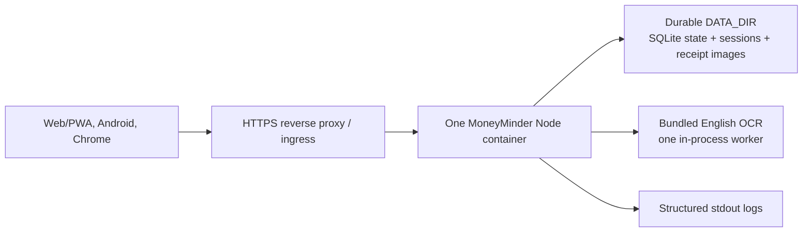

# MoneyMinder deployment and distribution

This is the operator runbook for the topology the repository actually supports:
one containerized Node service behind HTTPS and one durable `DATA_DIR` holding
the embedded SQLite database and receipt images.

Source hardening does not complete an external launch. Before enrolling anyone,
the operator must supply the domain, legal identity, contacts, processors,
retention periods, monitoring ownership, backup/restore evidence, signing
material, reviewer access, and incident/rollback decisions listed in
[production readiness](../PRODUCTION-READINESS.md).

## Supported production topology



Do not add application replicas to this design. The following are process-local
or single-owner:

- API/auth/OCR rate-limit counters;
- the OCR worker and its queue;
- recurring-bill scheduling;
- the receipt-delete retry worker;
- filesystem receipt storage;
- application mutation throughput through one serialized SQLite state document.

Horizontal scaling requires a shared limiter, shared/object image store,
distributed work ownership, measured OCR capacity, and a normalized or otherwise
concurrency-capable state model.

## Zero-cost OCI controlled pilot

The concrete, checked-in deployment surface is the
[OCI Always Free controlled-pilot package](../../deploy/oci/README.md). It uses:

- one ARM64 `VM.Standard.A1.Flex` VM with 2 OCPU/12 GB;
- a 50 GB boot volume and 100 GB attached block volume;
- one host-networked MoneyMinder container on port 3000, protected from public
  access by both the host firewall and OCI network security group;
- same-host Caddy as the only trusted proxy/TLS hop, requiring
  `TRUST_PROXY=loopback`;
- root-owned `0600` configuration and secret files;
- encrypted `DATA_DIR` recovery sets containing SQLite plus uploads and isolated restore
  drills, with every local, OCI, and off-tenancy copy expiring within 30 days.

The capacity envelope is capped at 30 active accounts, one app process, 25 MiB
of serialized state, and 4 GiB/10,000 receipt files globally. This is a
controlled-pilot policy, not load-test evidence.

OCR and SQLite do not require a VM. The VM is only the checked-in zero-cost way
to provide an always-reachable Node process, durable disk, and same-host TLS.
Another Linux host is valid if it satisfies the same one-instance contract.

This topology has no SLA and is not highly available. Oracle documents both
possible idle-instance reclamation and temporary A1 host-capacity shortages.
Never manufacture load to avoid reclamation. Maintain verified off-instance
backups, a reproducible rebuild path, and an approved paid escape route.

Before deploying to A1, run the ARM64 build gate after the required Node repin:

```bash
docker buildx build --platform linux/arm64 --load --tag moneyminder:arm64-smoke .
```

Current official limits and caveats are documented in
[OCI Always Free resources](https://docs.oracle.com/en-us/iaas/Content/FreeTier/freetier_topic-Always_Free_Resources.htm).
Recheck the provider page and every pinned image immediately before deployment.

## Release truth

- Runtime source pin: Node.js 24.18.0 and npm 10.9.8, temporarily release-blocked
  pending the announced patched Node.js 24.x build.
- Container base: a digest-pinned Node 24 Debian slim image.
- Production state and browser sessions: embedded SQLite under `DATA_DIR`.
- Android: WebView wrapper, minimum API 24, compile/target API 36.
- Chrome: Manifest V3 extension, version 1.1.0, minimum Chrome 102.
- PWA: manifest plus service worker; static shell only is offline-capable.

As recorded on 27 July 2026, the Node project has an announced security release
on 27 July. Any MoneyMinder deployment on or after that date is blocked until
the Dockerfile, package engine, and CI pin move to the patched Node 24 release
and the complete gate passes. Re-read
[production readiness](../PRODUCTION-READINESS.md) at release time rather than
copying an old pin into infrastructure.

## Configuration inventory

Values belong in the deployment platform's secret/config service. Never commit,
paste into documentation, or place production credentials in a release archive.
The authoritative annotated template is [`.env.example`](../../.env.example).

### Runtime production names

```text
NODE_ENV
APP_ORIGIN
SESSION_SECRET
DATA_DIR
SQLITE_FILE
PORT
LISTEN_HOST
TRUST_PROXY
REGISTRATION_ENABLED
PROMOTIONS_ENABLED
EXTENSION_ORIGIN
DATA_MAX_BYTES
UPLOAD_TOTAL_MAX_BYTES
UPLOAD_TOTAL_MAX_FILES
APP_TIME_ZONE
```

`NODE_ENV`, `APP_ORIGIN`, `SESSION_SECRET`, `DATA_DIR`, and `TRUST_PROXY` are
required for production. `SQLITE_FILE` defaults inside `DATA_DIR`; when set it
must be absolute and remain inside that directory. `LISTEN_HOST` defaults to and
only accepts `127.0.0.1`. Startup rejects a non-HTTPS app origin, weak session
secret, relative/non-durable storage, public bind, invalid origin, or invalid
numeric setting. `APP_TIME_ZONE` defaults to `Asia/Kolkata`.

`REGISTRATION_ENABLED` defaults closed in production. Open it only for a bounded
enrollment window. `PROMOTIONS_ENABLED` is a strict boolean that defaults to
false. Keep it false unless every
sponsored-offer gate in [production readiness](../PRODUCTION-READINESS.md) is
complete, including merchant/destination verification, finite metric retention,
and reconciled Play/privacy disclosures. `EXTENSION_ORIGIN` is optional;
omitting it disables production extension CORS. It must be the exact origin
derived from the real Chrome Web Store item ID.

### Rejected legacy storage names

```text
DATA_FILE
DATABASE_URL
DATABASE_POOL_MAX
PG_POOL_MAX
```

These names fail closed in every environment. Development and tests use the
same SQLite path, with disposable `DATA_DIR`/`SQLITE_FILE` values.

### Client release name

```text
MONEYMINDER_SERVER_URL
```

The Android and Chrome release builders both validate and bake this public HTTPS
origin into their artifacts. A domain change therefore requires new client
artifacts, not just a backend setting change.

Android upload signing uses the gitignored property names below, not environment
variables:

```text
storeFile
storePassword
keyAlias
keyPassword
```

Keep the permanent upload keystore and recovery copy outside the repository and
CI artifacts.

## Pre-deployment gate

Run from a clean checkout of the exact release commit:

```powershell
npm ci --ignore-scripts
npm audit --omit=dev --audit-level=low
npm run verify
git diff --check
```

The full CI workflow additionally runs a disposable SQLite restart/session test,
OSV dependency checks, container readiness/closed-enrollment/graceful-stop smoke
tests, exact Chrome package verification, Android strict-checksum
validation/lint/build, and scheduled drift checks. A green local test suite does
not replace those jobs.

Run the real database integration gate without external infrastructure:

```powershell
npm run test:sqlite
```

The test creates a disposable SQLite file, starts the production HTTP process,
persists account/session/receipt state, restarts, and verifies it again.

Build an immutable container image from the reviewed commit:

```powershell
docker build --pull --tag moneyminder:release .
docker image inspect moneyminder:release
```

Record the resulting image digest, source commit, lockfile hash, migration set,
and approval. Do not promote a mutable tag without recording its digest.

## Infrastructure contract

### HTTPS ingress

- Terminate public TLS at a controlled reverse proxy/ingress.
- Bind the Node process to `127.0.0.1`; `LISTEN_HOST` rejects other addresses.
- Set `TRUST_PROXY=loopback`. Production requires a same-host TLS reverse proxy
  because the Node process does not terminate TLS; `0`, numeric hop counts, and
  broader trust modes are rejected. Keep the Node port unreachable from
  untrusted clients.
- Preserve `X-Request-ID` and do not cache `/api/` or authenticated image
  responses.
- Use a request timeout of at least 75 seconds. The server bounds requests at 70
  seconds and OCR work at 30 seconds.
- Redirect HTTP to HTTPS before user traffic.

### Application container

- Run the checked-in Dockerfile as its non-root `node` user.
- Mount an absolute durable `DATA_DIR` with read/write permission for that UID.
- Send `SIGTERM` and allow at least 30 seconds at the platform boundary. The
  process stops intake, bounds HTTP drain, closes OCR/session/database resources,
  and exits.
- Start one container with at least the current readiness recommendation of
  1 vCPU and 1 GiB RAM; load-test before changing the cohort size.
- Do not copy `.env`, database dumps, upload data, logs, or signing material into
  the image.

### SQLite

Production uses:

- `app_state`: one bounded JSON application-state row;
- `user_sessions`: server-side browser sessions;
- `promotion_campaigns`: bounded, scheduled operator-controlled offer rows;
- `promotion_daily_metrics`: per-campaign UTC aggregate counts;
- `promotion_event_dedup`: hashed event-key retry receipts;
- `schema_migrations`: applied migration names.

Every app-state mutation is serialized in-process and guarded by a stored
version so a stale write cannot silently overwrite a newer value. WAL, full
synchronization, foreign keys, a busy timeout, a 64-write queue cap, and atomic
migrations are enabled. This does not make the service multi-instance safe.

The promotion tables are separate and disabled at the application boundary by
default. They do not normalize the core financial state or prove that a
campaign or merchant has been provisioned.

The serialized application state has a default 25 MiB ceiling. A write that
would grow past it fails with `507`; shrinking/deletion writes remain possible.
Receipt image bytes do not count toward this ceiling.

### Receipt volume

Receipt files live below `DATA_DIR/uploads/<account>/`, next to but not inside
the SQLite database.
Source-enforced defaults:

| Limit | Default/enforced value |
| --- | ---: |
| One upload | 5 MiB |
| One account | 200 files or 100 MiB |
| Whole volume | 10,000 files or 4 GiB |

Size the volume for backups, temporary filesystem overhead, and growth below
the configured ceiling. A full filesystem can fail before an application quota
does. Monitor free bytes and inodes independently.

## Migrations

SQL files in `server/migrations/` run in filename order inside an immediate
SQLite transaction. Production startup runs migrations before listening.

Preflight the release against a restored production-like database:

```powershell
npm run migrate
```

The command uses `SQLITE_FILE` (or its default inside `DATA_DIR`). Startup safely
rechecks the same idempotent set.

Migration rules:

1. Back up and restore-test before applying a new migration.
2. Never edit an already-applied SQL file; add the next numbered migration.
3. Make a migration backward-compatible with the previous application image
   when simple code rollback is required.
4. There are no automatic down migrations. Document a forward repair or a
   tested restore plan before shipping an incompatible change.
5. Stop the old container before migrating. The entire supported topology is
   single-instance.

## Backup and restore

The SQLite database and uploads form one logical `DATA_DIR` recovery set. A
database-only restore can leave receipt records without images; an uploads-only
restore can leave unreferenced images.

### Minimum backup policy

The operator must document:

- backup owner and on-call path;
- database mechanism, image-volume mechanism, encryption, and access control;
- frequency, retention, deletion expiry, and geographic/provider separation;
- recovery-point and recovery-time targets;
- last successful restore rehearsal;
- treatment of sessions and secrets during a security incident.

Source code does not choose these legal/operational values.

The checked-in OCI controlled-pilot package is intentionally stricter: it
prunes matching local encrypted recovery points at 30 days after a newly
verified backup, read-only verifies a private/versioning-disabled OCI bucket
with an enabled unfiltered delete lifecycle of 30 days or less, and makes
evidence of the weekly off-tenancy copy plus its 30-day expiry a launch and
every-release gate. Restore reconciliation against the external deletion
register remains mandatory.

### Consistent manual recovery point

For the current single-container design:

1. Announce maintenance and close enrollment.
2. Stop the container gracefully and wait for exit.
3. Run the checked-in SQLite backup command to a new path while the service is
   stopped, then archive the exact uploads tree.
4. Record both artifacts under one recovery-point identifier.
5. Verify checksums and encrypted off-service storage.
6. Restart the same image and confirm `/readyz`.

Low-level database commands:

```powershell
node server/sqlite-maintenance.js backup <ABSOLUTE_LIVE_DB> <ABSOLUTE_NEW_BACKUP>
node server/sqlite-maintenance.js restore <ABSOLUTE_BACKUP> <ABSOLUTE_NEW_RESTORED_DB>
```

The restore command verifies integrity/schema, removes browser sessions and
bearer tokens, rotates active account authentication versions, verifies again,
and atomically publishes a new file. It never overwrites source or destination.
Use the full `deploy/oci/backup.sh` and `restore-drill.sh` workflow in production.

### Restore rehearsal

1. Provision an isolated empty durable directory.
2. Restore the paired SQLite and uploads artifacts.
3. Point an isolated copy of the recorded application image at them.
4. Run migrations only if the tested recovery procedure requires them.
5. Verify `/livez`, `/readyz`, login, dashboard totals, a receipt image, a
   household balance, and pending settlement behavior.
6. Scan a new receipt, delete it, and verify the durable deletion retry path.
7. Record duration, data loss relative to the recovery point, failures, and
   corrective actions.
8. Destroy the rehearsal environment and its credentials.

Do not declare backups complete until this paired restore has succeeded.

## Health and monitoring

| Endpoint/signal | Meaning | Platform use |
| --- | --- | --- |
| `/livez` | Node process can answer HTTP; does not check dependencies | Liveness/restart probe |
| `/readyz` | `DATA_DIR` and the SQLite database are readable/writable | Readiness/traffic gate |
| `/healthz` | Same datastore-aware check as `/readyz` | External health monitor |

Readiness results are cached for two seconds. A `200` response means ready; a
`503` response means do not send user traffic.

The application emits structured JSON to stdout in production for startup,
completed HTTP requests, request errors, datastore errors, and shutdown
errors. Request logs include request ID, method, route, status, and duration—not
passwords or request bodies.

There is no built-in metrics exporter, alert manager, log retention policy,
distributed tracing, or operator dashboard. The operator must collect and alert
on at least:

- readiness failure, restart loop, abnormal exit, and TLS expiry;
- 5xx, `DB_BUSY`, `OCR_BUSY`, 429, and 507 rates;
- request/OCR latency and proxy timeouts;
- SQLite readiness, busy/full errors, state-row size, storage, and backup completion;
- `DATA_DIR` bytes, file count, free space, inodes, and failed delete retries;
- registration state changes and unexpected account growth;
- Chrome/Android client errors after a backend release.

Choose alert thresholds from load tests and the pilot's response commitments.
Do not log secrets, full URLs containing credentials, cookies, tokens, request
bodies, OCR text, or receipt images. Reverse-proxy IP logging and retention must
match the hosted privacy notice.

## Deployment sequence

1. Confirm every item in [production readiness](../PRODUCTION-READINESS.md).
2. Close registration and notify the pilot if the change needs downtime.
3. Create and verify a paired SQLite/uploads recovery point.
4. Run the complete release gate on the exact commit/image.
5. Preflight migrations against a restored production-like copy.
6. Deploy the immutable image to the single supported container slot.
7. Wait for `/readyz` before routing traffic.
8. Run browser login, dashboard, receipt scan/save/image/delete, household
   expense, UPI handoff, pending confirmation, export, and logout smoke tests.
9. Run the real Chrome extension against its configured origin.
10. Run the signed Android build on a physical device, including system receipt
    picker selection/cancellation, external intent return, and account deletion
    link.
11. Confirm `PROMOTIONS_ENABLED=false`, or attach the complete promotion
    activation/store/retention evidence before testing the exact enabled state.
12. Reopen controlled registration only after monitoring is stable.
13. Record image digest, migration names, test evidence, operator, time, and
    rollback point.

## Rollback

### Application-only rollback

Use when the database/volume are healthy and migrations remain compatible:

1. Close registration and stop new traffic.
2. Redeploy the previously recorded immutable image digest.
3. Wait for `/readyz`.
4. Verify login, dashboard totals, receipt image access, household balance, and
   one safe write.
5. Reopen traffic and continue incident monitoring.

The web/PWA frontend rolls back with the server image. Installed Android and
Chrome binaries do not. Preserve API and origin compatibility with those
clients.

### Data rollback/restore

A restore discards state newer than its recovery point and can resurrect rows
that users expected deleted. It is a high-impact incident action:

1. stop the service;
2. identify and approve the exact paired recovery set;
3. preserve forensic copies when the incident requires them;
4. restore SQLite and uploads together into isolation;
5. validate before switching traffic;
6. rotate session secrets/revoke sessions when compromise is possible;
7. reconcile post-recovery deletion/privacy obligations and notify affected
   users under the operator's incident policy.

Do not use a production restore merely to undo a bad display or compatible
application release.

## Distribution matrix

| Surface | Primary route | Alternative | Critical coupling |
| --- | --- | --- | --- |
| Web/PWA | Public HTTPS URL; browser install prompt/menu | Ordinary browser bookmark | Same live backend; static shell only offline |
| Android | Google Play signed App Bundle | Signed APK from controlled website/private channel | Public HTTPS origin baked into build |
| Chrome | Chrome Web Store ZIP | Unpacked development; enterprise-policy/self-hosted cases | Public HTTPS origin baked into ZIP; exact store item ID allowed by backend |

### Web/PWA

Deploying the server publishes the web app, manifest, icons, and service worker.
Supported browsers can install it from the URL without an app store. See
[web.dev's installation guidance](https://web.dev/learn/pwa/installation/) for
current browser behavior.

The service worker caches the app shell but never API responses. Treat this as
installability and resilient navigation, not offline budgeting.

### Google Play

The checked-in Android project builds a signed App Bundle only when the public
HTTPS origin and upload-keystore configuration pass fail-closed validation.
Use the detailed [Google Play upload guide](GOOGLE-PLAY-UPLOAD.md) and
[Android release runbook](../../android/RELEASE.md).

Current policy watch, verified 26 July 2026:

- Google Play requires Android App Bundles for new apps and Play App Signing for
  new apps. See [Android publishing](https://developer.android.com/studio/publish)
  and [bundle upload](https://developer.android.com/studio/publish/upload-bundle).
- From 31 August 2026, new apps and updates must target Android 16/API 36. The
  project currently targets 36, but recheck the
  [official target API policy](https://support.google.com/googleplay/android-developer/answer/11926878)
  immediately before submission.
- Apps with account creation need in-app deletion and a public web deletion
  resource. MoneyMinder implements both paths, but the hosted pages still need
  real operator values. See the
  [official deletion policy](https://support.google.com/googleplay/android-developer/answer/13327111).
- The Data safety form includes data handled through an app-controlled WebView.
  Reconcile the form with the deployed backend, logs, providers, and backups;
  use the [official Data safety guidance](https://support.google.com/googleplay/android-developer/answer/10787469).

Before the first store record, confirm the public product name and immutable
application ID. Before production review, provide safe reviewer credentials
with registration closed, final privacy/deletion URLs, receipt-picker behavior,
financial-features answers, content/target-audience declarations, and tested
store assets. The current AAB requests no `CAMERA` permission, so do not submit
a camera-permission declaration or claim live capture.

Alternative Android distribution is a signed release APK hosted on a controlled
website/private channel. Android documents this route in
[Publish your app](https://developer.android.com/studio/publish#publishing-unknown).
Users must permit installation from that source, and the operator assumes update
delivery, authenticity, revocation, support, and policy responsibilities. Never
distribute a debug APK or CI disposable-key artifact.

### Chrome Web Store

With `MONEYMINDER_SERVER_URL` already present in the release environment:

```powershell
npm run package:chrome
$Version = (Get-Content extension/manifest.json -Raw | ConvertFrom-Json).version
$Zip = "outputs/chrome-web-store/moneyminder-$Version.zip"
node scripts/verify-release-artifact.mjs chrome $Zip
```

The script validates one real public HTTPS origin, copies only the runtime
allowlist, rewrites the default API and host permission in staging, creates a
ZIP with `manifest.json` at its root, and removes staging. The verifier rejects
any file-set/origin mismatch and prints the exact ZIP SHA-256. Record that
digest with the source commit before upload.

The [official publication flow](https://developer.chrome.com/docs/webstore/publish/)
requires a registered developer account, ZIP upload, listing, single-purpose
and privacy declarations, distribution/test instructions, and review. After
the draft yields the stable item ID:

1. configure the backend's exact `EXTENSION_ORIGIN`;
2. rebuild the release ZIP with the same controlled backend origin;
3. test login, scoped reads/writes, logout/revocation, optional permission
   enable/disable, local detection, Track, and Dismiss;
4. submit the reviewed ZIP and store assets.

MoneyMinder's broad optional HTTPS-page permission is requested only when
purchase detection is enabled. The listing and in-product disclosure must state
that local page URL/host, Order/Invoice JSON-LD, and limited confirmation-page
text are processed, even though page text is not uploaded.

Chrome announced updated Limited Use and disclosure enforcement for 1 August
2026: collected user data must be necessary for the disclosed single purpose,
and all data collection must be prominently disclosed. Reconcile the package
and listing against the
[official July 2026 policy update](https://developer.chrome.com/blog/cws-policy-updates-2026)
and current [program policies](https://developer.chrome.com/docs/webstore/program-policies/)
immediately before submission.

For general users, Chrome Web Store is the supported direct-install route.
Unpacked loading is for trusted development. Chrome's
[distribution guidance](https://developer.chrome.com/docs/extensions/how-to/distribute)
limits self-hosting to managed/enterprise cases (with narrower Linux
exceptions); do not present a downloaded ZIP/CRX as a normal Windows/macOS
consumer distribution channel.

## External launch checklist

- [ ] Controlled domain, product name, and Android application ID confirmed.
- [ ] Node/base image repinned after every applicable security release.
- [ ] Production secrets/config installed without entering source or docs.
- [ ] Durable `DATA_DIR` provisioned, permission-checked, and capacity-tested.
- [ ] Paired backup and restore rehearsal passed.
- [ ] Every encrypted recovery copy expires within 30 days; the OCI lifecycle
      check passed and current weekly off-tenancy expiry evidence is attached.
- [ ] Monitoring, incident, rollback, restore, support, privacy, and grievance
      owners named.
- [ ] Hosted privacy/deletion pages contain real operator/processors/retention
      values and return HTTP 200 without authentication.
- [ ] Browser and physical-device picker-to-receipt journeys passed.
- [ ] Final deployment passes `verify-production-enrollment.mjs`: reviewer
      login works, invite-only access is disclosed, and closed registration has
      no visible dead CTA.
- [ ] Permanent Android upload key backed up; final AAB passes strict signature,
      known upload-certificate fingerprint, artifact digest, pinned bundletool
      digest, compiled production-origin resource, and bundle validation.
- [ ] Stable Chrome item ID configured; final ZIP passes exact allowlist,
      packaged-origin, and digest validation.
- [ ] Play and Chrome console declarations reconciled with the deployed system.
- [ ] `PROMOTIONS_ENABLED=false`, or the verified merchant/public HTTPS
      destination, finite metric lifecycle, Play **Contains ads** answer, hosted
      privacy notice, Data safety form, and enabled-device tests are approved.
- [ ] No `.env`, database/volume data, tokens, logs, exports, signing keys,
      build outputs, or test accounts leaked into release/shared artifacts.

## Related documents

- [Production readiness](../PRODUCTION-READINESS.md)
- [Product guide](../product/PRODUCT-GUIDE.md)
- [How MoneyMinder works](../product/HOW-IT-WORKS.md)
- [Google Play upload guide](GOOGLE-PLAY-UPLOAD.md)
- [Android release runbook](../../android/RELEASE.md)
- [Chrome extension implementation notes](../../extension/README.md)
- [Store upload kit](../../store-listing/README.md)
